# 🛡️ AI Agentic Audit Kit

> **Arsenal de Agentes Especialistas Verticales y Auditor Integrador Fullstack para cualquier Base de Código.**

Este repositorio implementa el patrón **Hub & Spoke Specialist Audit Pattern**: una arquitectura que combina **Especialistas Verticales de Láser Profundo** con un **Agente Integrador Fullstack**, permitiendo auditar, diagnosticar y refactorizar cualquier proyecto de software existente (sin importar su lenguaje o framework).

---

## 🏛️ Arquitectura Hub & Spoke (Especialistas + Árbitro)

```mermaid
flowchart TD
    subgraph "Spokes: Especialistas Verticales (Microscopio Forense)"
        F1["🏗️ 01_frontend/arch_and_network<br/>Arquitectura, Axios y Tipado TS"]
        F2["🧠 01_frontend/state_and_reactivity<br/>Stores, Reactividad y Memory Leaks"]
        F3["📝 01_frontend/forms_and_data_flow<br/>Validación Zod, UX y Double Submit"]
        F4["🎨 01_frontend/design_system_and_styling<br/>Tokens, Variantes, Temas y Layout"]
        F5["♿ 01_frontend/accessibility_and_wcag<br/>WCAG 2.1/2.2 AA, Teclado y ARIA"]
        B1["⚙️ 02_backend/api_rest_gateway<br/>Routes, Middlewares, Validation y HTTP Errors"]
        B2["🧩 02_backend/domain_business_logic<br/>Services, Transacciones ACID y DDD"]
        D1["🗄️ 03_database/query_performance_indexer<br/>N+1 Queries, B-Tree Indexes y DDL"]
        S1["🛡️ 04_security/owasp_threat_hunter<br/>IDOR, Inyecciones, JWT y Secrets"]
    end

    subgraph "Hub: Agente Integrador Fullstack (Telescopio Sistémico)"
        HUB["🧠 00_fullstack_integrator<br/>(Staff Cross-Layer Systems Architect)"]
    end

    subgraph "Entregables Finales"
        OUT1["📋 Reconciliación de Contratos API ↔ SPA"]
        OUT2["🏗️ Propuesta de Topología Limpia de Carpetas"]
        OUT3["🧪 Diagnóstico de Fallos y Trazabilidad E2E"]
    end

    F1 -.->|Atomic Finding| HUB
    F2 -.->|Atomic Finding| HUB
    F3 -.->|Atomic Finding| HUB
    F4 -.->|Atomic Finding| HUB
    F5 -.->|Atomic Finding| HUB
    B1 -.->|Atomic Finding| HUB
    B2 -.->|Atomic Finding| HUB
    D1 -.->|Atomic Finding| HUB
    S1 -.->|Atomic Finding| HUB

    HUB ==> OUT1
    HUB ==> OUT2
    HUB ==> OUT3

    style HUB fill:#003366,stroke:#38bdf8,color:#ffffff,stroke-width:2px
    style OUT1 fill:#064e3b,stroke:#34d399,color:#ffffff
    style OUT2 fill:#064e3b,stroke:#34d399,color:#ffffff
    style OUT3 fill:#064e3b,stroke:#34d399,color:#ffffff
```



---

## 🗂️ Estructura del Repositorio

```text
ai-agentic-audit-kit/
│
├── domains/                            # 🎯 Agentes Auditores Organizados por Dominio
│   │
│   ├── 00_fullstack_integrator/        # 🧠 EL HUB / ÁRBITRO CROSS-LAYER
│   │   ├── SYSTEM_PROMPT.md            # Rol maestro de Staff Systems Integrator
│   │   ├── CONTRACT_RECONCILER.md      # Metodología de cruce de contratos API ↔ SPA
│   │   ├── TOPOLOGY_REFACTORER.md      # Metodología de refactorización de carpetas
│   │   └── ONE_SHOT_PROMPT.md          # Invocación directa sobre todo el repo
│   │
│   ├── 01_frontend/                    # 🎨 DOMINIO FRONTEND (Escuadrón Colaborativo)
│   │   ├── 00_frontend_director/       # 👑 Director Rector del Dominio (Enrutador y consolidación)
│   │   ├── 01_arch_and_network/        # 🏗️ Arquitectura, modularización, Axios y TS
│   │   ├── 02_state_and_reactivity/    # 🧠 Stores Pinia/Zustand, memory leaks y re-renders
│   │   ├── 03_forms_and_data_flow/     # 📝 Formularios, validación Zod, doble submit y UX
│   │   ├── 04_design_system_and_styling/ # 🎨 Design System, tokens, temas y variantes
│   │   ├── 05_accessibility_and_wcag/  # ♿ WCAG 2.1/2.2 AA, navegación teclado y ARIA
│   │   └── protocols/                  # 🤝 Handoff Memo y Peer Rejection Protocol
│   │
│   ├── 02_backend/                     # ⚙️ DOMINIO BACKEND
│   │   ├── api_rest_gateway/           # Middlewares, Zod schemas, rate limit, envelopes
│   │   └── domain_business_logic/      # Casos de uso, transacciones ACID, clean code
│   │
│   ├── 03_database/                    # 🗄️ DOMINIO PERSISTENCIA
│   │   └── query_performance_indexer/  # N+1 queries, planes de ejecución, índices B-Tree
│   │
│   └── 04_security/                    # 🛡️ DOMINIO CIBERSEGURIDAD
│       └── owasp_threat_hunter/        # IDOR, OWASP Top 10, inyecciones, fuga de credenciales
│
├── protocols/                          # 🤝 Protocolos de Intercambio
│   └── AUDIT_INTEROP_PROTOCOL.md       # Estándar de entrega de hallazgos entre agentes
│
├── templates/                          # 📋 Plantillas de Dictámenes Forenses
│   ├── ATOMIC_FINDING_TEMPLATE.md      # Para hallazgos de especialistas individuales
│   └── FULLSTACK_SYNTHESIS_REPORT.md   # Dictamen integral del Agente Fullstack
│
└── guides/                             # 🚀 Guías de Operación
    ├── HOW_TO_INVOKE.md                # Guía de uso en Cursor, Antigravity, Claude, etc.
    └── SEVERITY_STANDARDS.md           # Matriz de severidad (CRITICAL, HIGH, MEDIUM, LOW)
```

---

## ⚡ ¿Cómo se Usa?

### Modo 1: Diagnóstico Quirúrgico (Especialista Aislado)
Úsalo cuando tengas una duda puntual en una capa específica:
1. Entra a la carpeta del especialista (ej. `domains/01_frontend/state_and_reactivity/`).
2. Abre `ONE_SHOT_PROMPT.md`, copia el prompt y reemplaza la ruta del archivo o módulo.
3. El agente te devolverá un reporte atómico con la severidad y el fix de código exacto.

### Modo 2: Diagnóstico y Reestructuración Integral (Agente Fullstack)
Úsalo cuando un flujo falle de extremo a extremo, haya desorden de carpetas o sospeches desalineación entre frontend y backend:
1. Abre `domains/00_fullstack_integrator/ONE_SHOT_PROMPT.md`.
2. Proporciona la ruta del frontend y del backend (o los reportes atómicos de los especialistas).
3. El Agente Fullstack actuará como árbitro: detectará discrepancias de contrato, localizará la causa raíz y te entregará una propuesta visual de arquitectura y estructura de carpetas.

---

## ⚖️ Licencia
MIT License.
