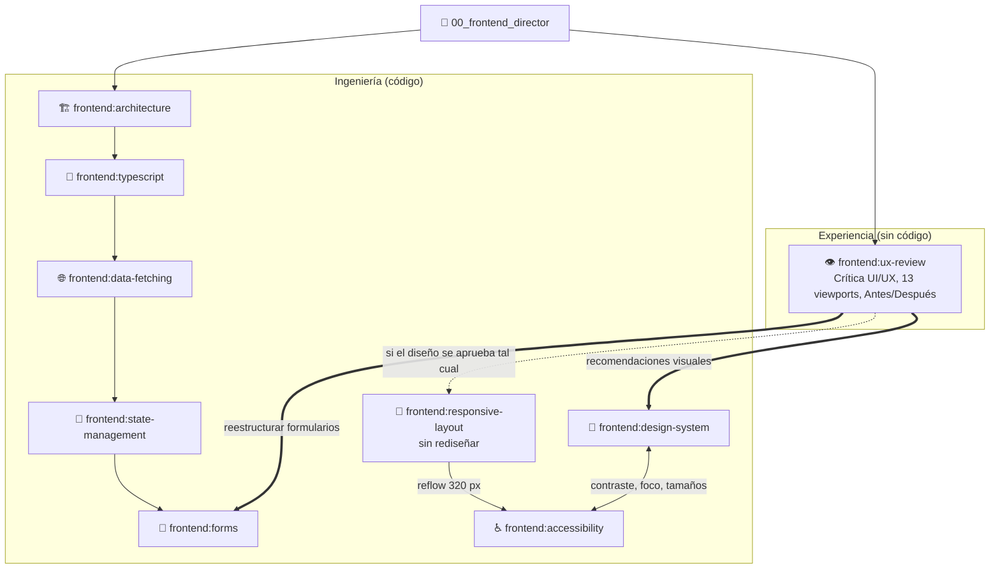

# 🧭 Manual de Enrutamiento del Dominio Frontend

> **Manual del `00_frontend_director` para combinar las skills del plugin `frontend`.**
> Todos los especialistas son ahora skills (`plugins/frontend/skills/`) que se invocan con `/frontend:<skill>`. Este director se migrará a la skill `frontend:audit` en la ola 4.

---

## 🗂️ Las dos vertientes



Las skills ya no se pasan memos entre sí: cada una tiene una sección **"Skills relacionadas"** que indica cuándo continuar con otra, y todas comparten severidad, formato de informe y matriz de viewports (`plugins/frontend/standards/`).

---

## 🛣️ Rutas

### Ruta 0 — Auditoría integral (producto + ingeniería)
```text
1. frontend:ux-review           → experiencia, jerarquía, responsive percibido, Antes/Después
2. frontend:architecture        → estructura y dependencias
3. frontend:typescript          → tipado y contratos
4. frontend:data-fetching       → capa de red y server state
5. frontend:state-management    → estado, memoria, reactividad
6. frontend:forms               → formularios
7. frontend:design-system       → tokens, componentes base, estados
8. frontend:accessibility       → WCAG 2.2 AA
9. frontend:responsive-layout   → correcciones de layout sin rediseño (solo lo aprobado en el paso 1)
```
**Cuándo:** auditoría completa de una feature o módulo nuevo antes de un release.

### Ruta 1 — Crítica de UX pura
```text
frontend:ux-review
```
**Cuándo:** "la pantalla se ve anticuada / incómoda / apretada en el móvil"; se quiere un plan de rediseño priorizado.

### Ruta 2 — Rendimiento y memoria
```text
frontend:state-management → frontend:data-fetching → frontend:design-system (animaciones)
```
**Cuándo:** pestaña congelada, memoria creciente, re-renders, peticiones duplicadas, animaciones que saturan la GPU. *(La skill `frontend:performance` de la ola 3 cubrirá Core Web Vitals y bundle.)*

### Ruta 3 — Flujo de captura de datos
```text
frontend:data-fetching → frontend:forms → frontend:accessibility (formularios)
```
**Cuándo:** errores al enviar, validaciones rotas, doble envío, errores del servidor que no se muestran.

### Ruta 4 — Visual e inclusiva
```text
frontend:design-system ⇄ frontend:accessibility
```
**Cuándo:** auditar tokens, temas, estados interactivos y conformidad WCAG.

### Ruta 5 — Responsive sin rediseño
```text
frontend:responsive-layout
```
**Cuándo:** el diseño está aprobado y se desborda en `1366 × 768`, tablet o móvil.

### Ruta 6 — Cimientos técnicos
```text
frontend:architecture → frontend:typescript → frontend:data-fetching
```
**Cuándo:** proyecto nuevo o caótico; carpetas desordenadas, `any`, llamadas HTTP en componentes.

---

## ⚖️ Selección rápida

| Petición | Ruta |
| :--- | :---: |
| "Revisa este módulo de principio a fin" | 0 |
| "Dime si la experiencia es buena y cómoda en móvil" | 1 |
| "La pestaña se congela o consume mucha RAM" | 2 |
| "El formulario no guarda o envía datos erróneos" | 3 |
| "Audita tokens, temas y accesibilidad" | 4 |
| "El diseño está aprobado pero se desborda" | 5 |
| "Ordena la estructura y el tipado del proyecto" | 6 |
