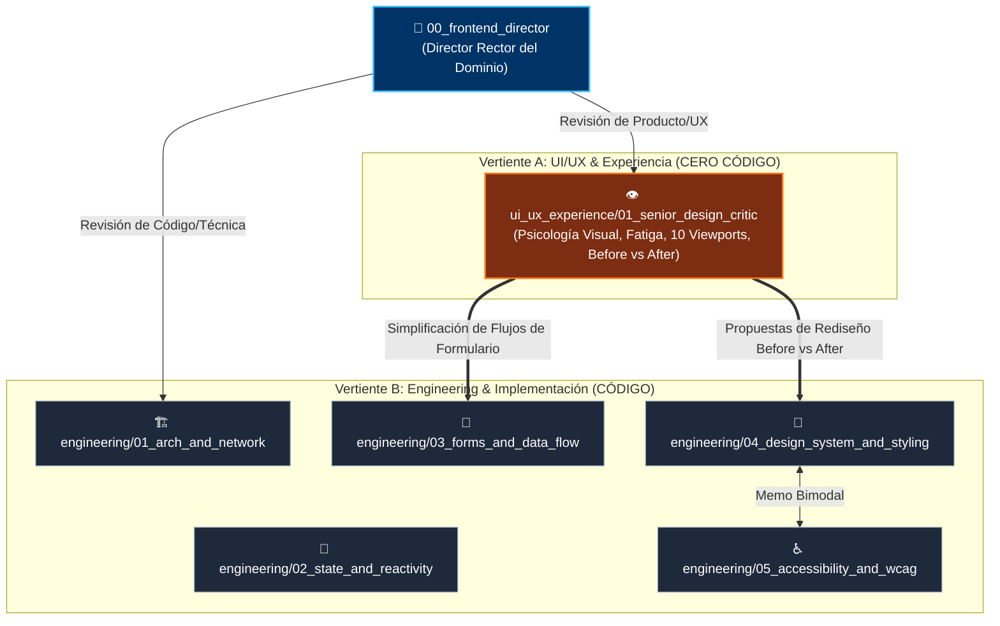

# 🧭 Manual de Enrutamiento y Rutas de Auditoría (Frontend Routing Playbook)

> **Manual Rector del `00_frontend_director` para coordinar el Escuadrón de Frontend:**  
> Divide el dominio en dos vertientes: **Experiencia y Crítica Visual (CERO CÓDIGO)** vs **Ingeniería e Implementación Técnica (CÓDIGO)**.

---

## 🗂️ Las Dos Vertientes del Dominio Frontend



---

## 🛣️ Rutas de Ejecución Predefinidas

### Ruta 0: "Auditoría de Producto y Experiencia Integral (UX-First Full Audit)"
* **Secuencia de Cadena:**
  ```text
  1. ui_ux_experience/01_senior_design_critic (Evalúa interfaz en 10 resoluciones, fatiga, jerarquía y Before vs After)
         ↓ (Handoff de Diseño a Código)
  2. engineering/01_arch_and_network (Cimientos de carpetas y cliente de red)
         ↓ (Handoff Memo)
  3. engineering/02_state_and_reactivity (Stores y reactividad)
         ↓ (Handoff Memo)
  4. engineering/03_forms_and_data_flow (Implementación de formularios simplificados)
         ↓ (Handoff Memo)
  5. engineering/04_design_system_and_styling (Ajuste de tokens, variantes y componentes base)
         ↓ (Handoff Memo)
  6. engineering/05_accessibility_and_wcag (Certificación de lectores de pantalla y teclado)
  ```
* **Cuándo activarla:** Para auditorías completas de nuevas funcionalidades donde importa tanto la usabilidad humana como la solidez técnica del software.

---

### Ruta 1: "Crítica Pura de UI/UX y Mobile (Zero-Code Design Critique)"
* **Secuencia de Cadena:**
  ```text
  ui_ux_experience/01_senior_design_critic (Ejecución Aislada Rápida)
  ```
* **Cuándo activarla:**
  - Cuando el cliente o equipo dice: *"La pantalla se ve anticuada, incómoda o el teléfono muestra todo apretado"*.
  - Cuando necesitas evaluar las 10 resoluciones de pantalla (320px a 1920px) sin perder tiempo leyendo código TypeScript.
  - Para obtener el informe *Before vs After* y roadmap P0-P3 de rediseño.

---

### Ruta 2: "Crisis de Rendimiento y Memoria (Performance Crisis)"
* **Secuencia de Cadena:**
  ```text
  engineering/02_state_and_reactivity ➔ engineering/04_design_system_and_styling
  ```
* **Cuándo activarla:** Pestaña congelada, memory leaks o animaciones CSS que saturan la GPU.

---

### Ruta 3: "Flujo de Formularios y Captura (Data Input Flow)"
* **Secuencia de Cadena:**
  ```text
  engineering/01_arch_and_network ➔ engineering/03_forms_and_data_flow
  ```
* **Cuándo activarla:** Errores de envío, validaciones Zod rotas o doble clic accidental.

---

### Ruta 4: "Dúo Visual & Inclusivo (Design System + Certificación WCAG)"
* **Secuencia de Cadena (Bimodal Complementaria):**
  ```text
  engineering/04_design_system_and_styling ⇄ engineering/05_accessibility_and_wcag
  ```
* **Cuándo activarla:** Auditoría técnica de tokens, estados interactivos y cumplimiento de accesibilidad legal.

---

## ⚖️ Criterios de Selección Rápida

| Requerimiento del Usuario | Ruta Recomendada | Enfoque Principal |
| :--- | :---: | :--- |
| "Audita la experiencia, el diseño y dime si es cómodo en teléfonos" | **Ruta 1** (UI/UX Pure Critique) | 👁️ Cero código, 10 viewports, fatiga visual. |
| "Revisa este nuevo módulo de principio a fin (diseño + código)" | **Ruta 0** (UX-First Full Audit) | 🌟 Producto + Ingeniería completa. |
| "La pestaña se congela o consume 2GB de RAM" | **Ruta 2** (Performance Crisis) | ⚙️ Stores, memory leaks y GPU. |
| "El formulario no guarda o se envían datos erróneos" | **Ruta 3** (Data Input Flow) | ⚙️ Zod, submit y endpoints. |
| "Audita tokens, temas y conformidad de accesibilidad WCAG" | **Ruta 4** (Dúo Visual & A11y) | 🎨 Tokens, teclado y lectores de pantalla. |
