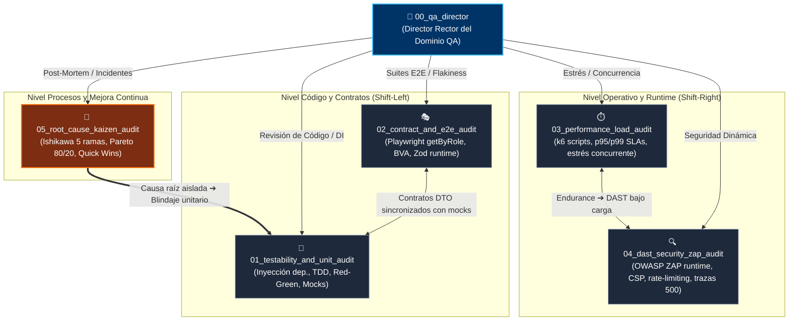

# 🧭 Manual de Enrutamiento y Rutas de Auditoría QA (QA Routing Playbook)

> **Manual Rector del `00_qa_director` para coordinar el Escuadrón de Calidad, Arquitectura de Pruebas y Resiliencia.**

---

## 🗂️ Arquitectura de Especialistas del Dominio QA



---

## 🛣️ Las 4 Rutas Canónicas de Ejecución

### Ruta 1: "Crisis de Regresiones en Producción y Post-Mortem (Root Cause & Hardening)"
* **Secuencia de Cadena:**
  ```text
  1. 05_root_cause_kaizen_audit (Construye Diagrama de Ishikawa 5 ramas y aísla el 20% crítico con Pareto)
         ↓ (Handoff de Causas a Blindaje de Código)
  2. 01_testability_and_unit_audit (Refactoriza lógica acoplada con Inversión de Dependencias y crea test determinista que reproduce y previene el bug)
  ```
* **Cuándo activarla:** Tras una caída crítica en producción, un rollback de emergencia o cuando el equipo reporta que *"un bug solucionado hace dos semanas volvió a aparecer"*.

---

### Ruta 2: "Certificación Holística Pre-Release (Full-Stack Quality Gate)"
* **Secuencia de Cadena:**
  ```text
  1. 01_testability_and_unit_audit (Verifica aislamiento de dependencias y calidad de aserciones en servicios clave)
         ↓
  2. 02_contract_and_e2e_audit (Verifica contratos DTO cliente-servidor y flujos críticos de usuario sin esperas fijas)
         ↓
  3. 03_performance_load_audit (Valida SLAs p95/p99 y resistencia del pool de conexiones bajo k6)
         ↓
  4. 04_dast_security_zap_audit (Verifica cabeceras HTTP, rate-limits en login y blindaje de errores 500)
         ↓
  5. 00_qa_director (Consolida el veredicto emitiendo templates/QA_MATURITY_SCORECARD_TEMPLATE.md)
  ```
* **Cuándo activarla:** Previo al lanzamiento a producción de un nuevo producto, módulo transaccional o migración de infraestructura.

---

### Ruta 3: "Saneamiento y Estabilización de CI/CD (Anti-Flakiness & Contract Drift)"
* **Secuencia de Cadena:**
  ```text
  1. 02_contract_and_e2e_audit (Erradica selectores frágiles CSS/XPath, elimina sleep/waitForTimeout y valida contratos Zod)
         ↓
  2. 01_testability_and_unit_audit (Optimiza tiempos de ejecución y aísla efectos secundarios para permitir ejecución paralela limpia)
  ```
* **Cuándo activarla:** Cuando la canalización de CI tarda demasiado, falla de forma intermitente (*flaky tests*) o los desarrolladores comienzan a ignorar alertas del pipeline.

---

### Ruta 4: "Resiliencia Operativa y Defensa en Runtime (Stress & DAST Hardening)"
* **Secuencia de Cadena:**
  ```text
  1. 03_performance_load_audit (Diseña y ejecuta escenarios escalonados en k6 para detectar cuellos de botella)
         ↓
  2. 04_dast_security_zap_audit (Evalúa la exposición de endpoints sensibles, headers de protección y control de fuerza bruta)
  ```
* **Cuándo activarla:** Preparación para eventos de tráfico masivo (Black Friday, picos de cierre de mes) o auditorías de cumplimiento operativo y seguridad en staging.

---

## ⚖️ Criterios de Selección Rápida

| Síntoma o Requerimiento del Usuario | Ruta Recomendada | Especialistas Involucrados |
| :--- | :---: | :--- |
| "Se cayó la base de datos o reapareció un bug de pagos en producción" | **Ruta 1** (Post-Mortem & Hardening) | `05_root_cause` ➔ `01_testability` |
| "Vamos a lanzar a producción en 3 días y queremos certificar calidad global" | **Ruta 2** (Certificación Pre-Release) | `01` ➔ `02` ➔ `03` ➔ `04` ➔ `Director Scorecard` |
| "El pipeline de CI es lentísimo y las pruebas fallan aleatoriamente" | **Ruta 3** (Anti-Flakiness CI/CD) | `02_contract_and_e2e` ➔ `01_testability` |
| "Queremos saber si el backend soporta 500 usuarios concurrentes sin tumbarse" | **Ruta 4** (Resiliencia Operativa) | `03_performance_load` + `04_dast_security` |
| "Solo necesito auditar un servicio puntual para hacerlo testeable con mocks" | **Invocación Quirúrgica** | `01_testability_and_unit_audit` directamente |
| "Solo necesito un script k6 para simular carga en una API" | **Invocación Quirúrgica** | `03_performance_load_audit` directamente |
