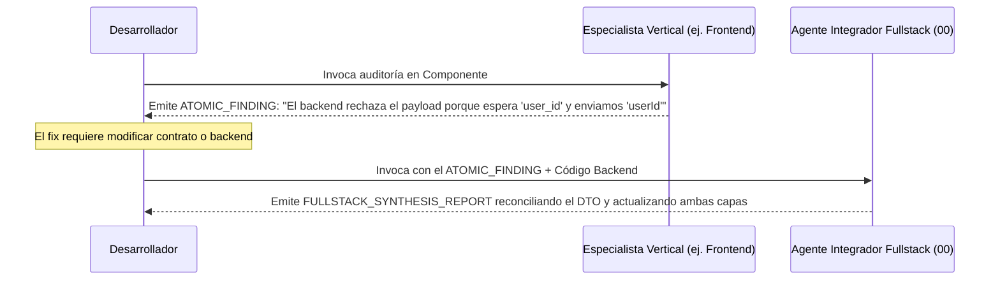

# 🚀 Manual Operativo de Invocación por Dominio (Domain Audit Playbook)

> **Guía exhaustiva para saber qué hace cada agente, cuándo activarlo, cuándo NO usarlo y cómo pasarle el contexto exacto.**

Este manual sirve como brújula para cualquier desarrollador o líder técnico que desee auditar un proyecto con el kit. Cada agente está diseñado con **visión hiper-especializada**: sabe mucho de su área y rechaza distraerse con otras capas.

---

## 🧭 1. Árbol de Decisión Rápido (Triage de Problemas)

| Si tu síntoma o necesidad es... | El agente indicado es... | Ruta en el Kit |
| :--- | :--- | :--- |
| Un formulario envía datos pero el servidor rechaza con 400 Bad Request o campos vacíos. | **00_fullstack_integrator** | `domains/00_fullstack_integrator/` |
| El proyecto tiene carpetas desordenadas, tipos duplicados o no sabes cómo estructurarlo. | **00_fullstack_integrator** | `domains/00_fullstack_integrator/` |
| Quieres auditar un módulo de frontend completo y coordinar a los especialistas. | **00_frontend_director** | `domains/01_frontend/00_frontend_director/` |
| Estructura caótica de carpetas frontend, llamadas directas de axios en vistas, tipos 'any'. | **01_arch_and_network** | `domains/01_frontend/01_arch_and_network/` |
| La página se congela, la memoria RAM del navegador no para de subir o hay re-renders infinitos. | **02_state_and_reactivity** | `domains/01_frontend/02_state_and_reactivity/` |
| Formularios complejos, validación Zod, prevención de doble clic y estados isSubmitting. | **03_forms_and_data_flow** | `domains/01_frontend/03_forms_and_data_flow/` |
| Colores hardcodeados, quiebres de Dark/Light mode, variantes CVA o layout widescreen roto. | **04_design_system_and_styling** | `domains/01_frontend/04_design_system_and_styling/` |
| Trampas de teclado, focus trap/restoration en modales, ratios de contraste WCAG y ARIA. | **05_accessibility_and_wcag** | `domains/01_frontend/05_accessibility_and_wcag/` |
| Peticiones quedan colgadas sin responder (timeout) o no hay validación de tipos en el body. | **api_rest_gateway** | `domains/02_backend/api_rest_gateway/` |
| Controladores gigantes de 800 líneas, cálculos de saldo sin transacciones ACID. | **domain_business_logic** | `domains/02_backend/domain_business_logic/` |
| Una consulta tarda 2 segundos, sospechas de consultas N+1 en bucles o faltan índices. | **query_performance_indexer** | `domains/03_database/query_performance_indexer/` |
| Quieres verificar si un usuario puede ver facturas ajenas (IDOR), inyecciones SQL o secrets en repo. | **owasp_threat_hunter** | `domains/04_security/owasp_threat_hunter/` |

---

## 🏛️ 2. Guía Detallada Agente por Agente

---

### 🧠 DOMINIO 00: EL HUB INTEGRADOR

#### Agente: `00_fullstack_integrator` (Staff Cross-Layer Systems Architect)

* **¿Qué hace exactamente?**
  Es el **árbitro y arquitecto sistémico**. Inspecciona la frontera entre el cliente (SPA) y el servidor (API), detectando divergencias en contratos (camelCase vs snake_case, DTOs incompatibles), diagnosticando fallos en cascada E2E y diseñando la topología limpia de carpetas de todo el repositorio.
* **¿Cuándo DEBES usarlo?**
  - Cuando un flujo que involucra UI ➔ Network ➔ API ➔ Base de datos falla y no sabes en qué capa está la culpa.
  - Cuando Frontend y Backend han evolucionado por separado y sospechas que hay endpoints desfasados o rotos.
  - Cuando el repositorio es un monorock o código espagueti y necesitas una propuesta visual de reestructuración limpia sin romper producción.
* **¿Cuándo NO debes usarlo?**
  - ❌ **NO lo uses** para revisar si un botón tiene mal contraste de color (usa `04_ui_design_and_a11y`).
  - ❌ **NO lo uses** para optimizar una consulta SQL puntual que ya identificaste como lenta (usa `query_performance_indexer`).
  - ❌ **NO lo uses** para revisar fugas de memoria en hooks de React o composables de Vue (usa `02_state_and_reactivity`).
* **¿Cómo invocarlo y qué insumos darle?**
  - **Insumos mínimos:** Ruta de la carpeta Frontend + Ruta de la carpeta Backend.
  - **Prompt sugerido:**
    ```text
    Actúa como 00_fullstack_integrator. Audita la integración entre Frontend ([ruta/frontend]) y Backend ([ruta/backend]). Identifica discrepancias de contratos, fallos E2E y propón una estructura limpia de carpetas bajo templates/FULLSTACK_SYNTHESIS_REPORT.md.
    ```

---

### 🎨 DOMINIO 01: ESCUADRÓN COLABORATIVO FRONTEND

#### Agente: `00_frontend_director` (Frontend Engineering Director)

* **¿Qué hace exactamente?**
  Es el **Director Rector del dominio**. No audita líneas aisladas; evalúa tu objetivo, selecciona la ruta de auditoría (`ROUTING_PLAYBOOK.md`), activa a los especialistas en el orden exacto, vigila que los handoffs cumplan calidad y emite el dictamen consolidado del frontend.
* **¿Cuándo DEBES usarlo?**
  - Para auditar una pantalla, módulo o feature completa de principio a fin.
  - Cuando quieras que los 4 especialistas trabajen en equipo sin tener que coordinarlos manualmente.
* **¿Cuándo NO debes usarlo?**
  - ❌ **NO lo uses** si solo quieres auditar una tarea micro aislada de 2 minutos (invoca al especialista directo).
* **¿Cómo invocarlo y qué insumos darle?**
  - **Insumos mínimos:** Ruta del módulo frontend + objetivo de la auditoría.
  - **Prompt sugerido:**
    ```text
    Actúa como 00_frontend_director. Audita el módulo en [ruta/modulo]. Selecciona la ruta de auditoría adecuada, orquesta a tus especialistas (01 a 04) usando INTER_AGENT_HANDOFF_MEMO.md y consolida el dictamen final.
    ```

---

#### Agente: `01_arch_and_network` (Frontend Architect & Network Specialist)

* **¿Qué hace exactamente?**
  Audita los **cimientos de código**: modularización de carpetas, cliente Axios/Fetch centralizado, interceptores de autenticación/refresh token, tipado estricto en TypeScript (cero `any`) y cancelación de peticiones con `AbortController`.
* **¿Cuándo DEBES usarlo?**
  - Vistas y componentes haciendo llamadas directas a `axios.get/post`.
  - Falta de tipado en DTOs o proliferación de tipos `any`.
  - Peticiones que quedan vivas al cambiar de página consumiendo ancho de banda.
* **¿Cuándo NO debes usarlo?**
  - ❌ **NO lo uses** para revisar si un modal es accesible por teclado (usa `04_ui_design_and_a11y`).
* **¿Cómo invocarlo?**
  - `domains/01_frontend/01_arch_and_network/ONE_SHOT_PROMPT.md`

---

#### Agente: `02_state_and_reactivity` (State & Reactivity Specialist)

* **¿Qué hace exactamente?**
  Audita el **motor reactivo**: stores de Pinia/Zustand/Redux, fugas de memoria en desmontaje (`removeEventListener`, `clearInterval`, sockets) y pérdida de reactividad o render loops.
* **¿Cuándo DEBES usarlo?**
  - Pestaña del navegador pesada o lenta con memoria RAM creciendo sin parar.
  - Re-renders infinitos o componentes que no actualizan al cambiar variables reactivas.
* **¿Cuándo NO debes usarlo?**
  - ❌ **NO lo uses** para revisar la validación de inputs de formularios (usa `03_forms_and_data_flow`).
* **¿Cómo invocarlo?**
  - `domains/01_frontend/02_state_and_reactivity/ONE_SHOT_PROMPT.md`

---

#### Agente: `03_forms_and_data_flow` (Forms & Input Engineering Specialist)

* **¿Qué hace exactamente?**
  Audita la **captura e interacción de datos**: validaciones declarativas con Zod/VeeValidate, prevención de doble envío (Double Submit con bloqueo de botón), formularios multi-paso (wizards) y mapeo de errores 422 a los campos correspondientes.
* **¿Cuándo DEBES usarlo?**
  - Formularios que permiten enviar múltiples veces al hacer clic rápido.
  - Validación manual con `if/else` desordenada en vez de esquemas declarativos.
  - Listas dinámicas de campos donde al borrar una fila se corrompe el formulario.
* **¿Cuándo NO debes usarlo?**
  - ❌ **NO lo uses** para revisar colores o contrastes de accesibilidad (usa `04_ui_design_and_a11y`).
* **¿Cómo invocarlo?**
  - `domains/01_frontend/03_forms_and_data_flow/ONE_SHOT_PROMPT.md`

---

#### Agente: `04_design_system_and_styling` (Lead Design System & UI Architecture Engineer)

* **¿Qué hace exactamente?**
  Audita la **arquitectura visual y consistencia de componentes**: tokens de diseño, coherencia en Dark/Light mode, variantes polimórficas (CVA), matriz completa de estados (`hover`, `active`, `focus-visible`, `disabled`, `loading`), resiliencia de layout (widescreen, prevención de CLS y desborde de textos largos) y optimización de SVGs/animaciones por GPU.
* **¿Cuándo DEBES usarlo?**
  - Para auditar componentes base atómicos (`BaseButton`, `BaseInput`, `BaseModal`, `BaseBadge`, `BaseCard`).
  - Cuando detectes valores hexadecimales `#...` o medidas arbitrarias hardcodeadas en CSS/style.
  - Cuando el modo oscuro rompe la legibilidad o deja textos invisibles.
  - Para verificar que botones e inputs soporten todos los estados interactivos sin deformarse.
* **¿Cuándo NO debes usarlo?**
  - ❌ **NO lo uses** para auditar lectores de pantalla o cumplimiento estricto WCAG (usa `05_accessibility_and_wcag`).
  - ❌ **NO lo uses** para revisar llamadas a APIs o lógica asíncrona de stores.
* **🤝 Interacción con Accesibilidad:**
  - Si auditas un componente compuesto interactivo (Modal, Dropdown, Tabs) y notas que carece de navegación por teclado o roles ARIA, emites una nota en tu handoff memo solicitando la intervención de `05_accessibility_and_wcag`.
* **¿Cómo invocarlo?**
  - `domains/01_frontend/04_design_system_and_styling/ONE_SHOT_PROMPT.md`

---

#### Agente: `05_accessibility_and_wcag` (Principal Web Accessibility Engineer - WCAG 2.1/2.2 AA)

* **¿Qué hace exactamente?**
  Audita de forma forense la **inclusión digital, lectores de pantalla y conformidad legal WCAG**: navegación 100% por teclado, focus traps y focus restoration al cerrar modales con `Escape`, ratios de contraste (4.5:1 texto, 3:1 UI), árbol ARIA (`aria-expanded`, `aria-live` en regiones activas), formularios con labels y errores asociados (`aria-describedby`), tamaño mínimo táctil en móvil (24x24px / 44x44px) y `@media (prefers-reduced-motion)`.
* **¿Cuándo DEBES usarlo?**
  - Antes de liberar un release público para certificar legalmente cumplimiento de accesibilidad.
  - Para auditar la experiencia con lectores de pantalla (NVDA, JAWS, VoiceOver).
  - Cuando modales o drawers pierden el foco al cerrarse o no se pueden operar con teclado.
  - Para verificar que los mensajes de error dinámicos sean anunciados a usuarios con discapacidad visual.
* **¿Cuándo NO debes usarlo?**
  - ❌ **NO lo uses** para revisar la modularización de carpetas o cliente Axios.
  - ❌ **NO lo uses** para depurar lógica de cálculo o mutaciones de stores.
* **🤝 Interacción con Design System:**
  - Si detectas que un contraste de color no cumple (ej. 3.2:1) o que un botón táctil mide menos de 44px, emites un memo hacia `04_design_system_and_styling` para que ajuste el token de color o el padding del componente base.
* **¿Cómo invocarlo?**
  - `domains/01_frontend/05_accessibility_and_wcag/ONE_SHOT_PROMPT.md`

---

### ⚙️ DOMINIO 02: BACKEND SPECIALISTS

#### Agente: `api_rest_gateway` (HTTP Routing & Perimetral Security)

* **¿Qué hace exactamente?**
  Audita los routers de Express/Fastify/NestJS, middlewares perimetrales, validación estricta de payloads (Zod, Joi), rate limiting, cabeceras de seguridad y manejo global de errores HTTP.
* **¿Cuándo DEBES usarlo?**
  - Quieres verificar si tus endpoints están blindados contra payloads malformados o inyecciones de campos no permitidos.
  - Clientes reportan timeouts aleatorios (middlewares que no invocan `next()`).
  - Las respuestas de error devuelven formatos dispares o filtran stack traces de Node.js en producción.
* **¿Cuándo NO debes usarlo?**
  - ❌ **NO lo uses** para auditar cálculos matemáticos o reglas complejas de facturación (usa `domain_business_logic`).
  - ❌ **NO lo uses** para optimizar queries SQL (usa `query_performance_indexer`).
* **¿Cómo invocarlo y qué insumos darle?**
  - **Insumos mínimos:** Archivos de rutas (`routes.ts`), middlewares (`middlewares/`) y esquemas de validación.
  - **Prompt sugerido:**
    ```text
    Actúa como 02_backend/api_rest_gateway. Audita las rutas en [ruta/backend/routes] y middlewares. Revisa validación perimetral de esquemas Zod, rate limiting y el error handler centralizado bajo templates/ATOMIC_FINDING_TEMPLATE.md.
    ```

---

#### Agente: `domain_business_logic` (Domain Architecture & Clean Code)

* **¿Qué hace exactamente?**
  Audita los servicios de aplicación y dominio, erradicando controladores obesos, garantizando transaccionalidad ACID en operaciones de múltiples pasos y asegurando que las reglas del negocio no dependan de HTTP ni del framework.
* **¿Cuándo DEBES usarlo?**
  - Tus controladores tienen más de 100 líneas y mezclan consultas SQL con lógica condicional.
  - Hay operaciones críticas (ej. cobro de orden + descuento de stock) que si fallan a la mitad dejan la base de datos corrupta.
  - Quieres desacoplar el core del negocio para poder ejecutarlo en un worker o script CLI sin levantar un servidor HTTP.
* **¿Cuándo NO debes usarlo?**
  - ❌ **NO lo uses** para revisar headers HTTP, CORS o cookies (usa `api_rest_gateway`).
  - ❌ **NO lo uses** para diseñar índices B-Tree de PostgreSQL (usa `query_performance_indexer`).
* **¿Cómo invocarlo y qué insumos darle?**
  - **Insumos mínimos:** Servicios (`services/`), controladores (`controllers/`) o módulos de dominio.
  - **Prompt sugerido:**
    ```text
    Actúa como 02_backend/domain_business_logic. Audita [ruta/backend/services/orders.service.ts]. Busca transacciones ACID ausentes, controladores con lógica de negocio indebida y violaciones a Clean Architecture bajo templates/ATOMIC_FINDING_TEMPLATE.md.
    ```

---

### 🗄️ DOMINIO 03: PERSISTENCIA Y BASE DE DATOS

#### Agente: `query_performance_indexer` (Database Reliability Engineer)

* **¿Qué hace exactamente?**
  Audita repositorios de datos, consultas SQL/ORM y migraciones DDL. Caza consultas N+1 en bucles, escaneos secuenciales (Seq Scan), consultas no SARGables (`LIKE '%abc%'`), y diseña índices B-Tree compuestos.
* **¿Cuándo DEBES usarlo?**
  - La API tarda más de 500ms en responder consultas que listan registros.
  - En logs de base de datos ves cientos de queries ejecutándose por cada petición (N+1).
  - Tienes tablas de más de 50,000 filas y sospechas que faltan índices en llaves foráneas o filtros compuestos.
* **¿Cuándo NO debes usarlo?**
  - ❌ **NO lo uses** para revisar la interfaz gráfica o llamadas de Axios.
  - ❌ **NO lo uses** para auditar permisos de usuario o autenticación JWT (usa `owasp_threat_hunter`).
* **¿Cómo invocarlo y qué insumos darle?**
  - **Insumos mínimos:** Archivos de repositorio (`repositories/`), migraciones DDL (`migrations/` o `schema.sql`) o queries crudas.
  - **Prompt sugerido:**
    ```text
    Actúa como 03_database/query_performance_indexer. Audita las consultas en [ruta/backend/src/repositories] y el esquema DDL. Detecta N+1 queries y propón los índices B-Tree óptimos bajo templates/ATOMIC_FINDING_TEMPLATE.md.
    ```

---

### 🛡️ DOMINIO 04: CIBERSEGURIDAD Y APPSEC

#### Agente: `owasp_threat_hunter` (Application Security & Pentesting)

* **¿Qué hace exactamente?**
  Realiza análisis estático forense de seguridad. Detecta vulnerabilidades IDOR (modificar o ver datos de otra cuenta cambiando el ID en la URL), inyecciones SQL/NoSQL/Command, secretos o tokens hardcodeados y configuraciones laxas de JWT.
* **¿Cuándo DEBES usarlo?**
  - Antes de pasar cualquier funcionalidad o módulo nuevo a producción.
  - Al implementar un nuevo sistema de autenticación, login social o roles de usuario (RBAC).
  - Para auditar si la aplicación aísla correctamente los datos en entornos multi-inquilino (Multi-Tenant).
* **¿Cuándo NO debes usarlo?**
  - ❌ **NO lo uses** para medir rendimiento de carga o tiempos de respuesta.
  - ❌ **NO lo uses** para refactorizar nombres de variables o formateo estético de código.
* **¿Cómo invocarlo y qué insumos darle?**
  - **Insumos mínimos:** Módulos de autenticación, controladores que reciben IDs de entidades, y archivos `.env.example` o de configuración.
  - **Prompt sugerido:**
    ```text
    Actúa como 04_security/owasp_threat_hunter. Audita el módulo [ruta/backend/src/modules/billing] y su middleware de autenticación. Busca vulnerabilidades IDOR, inyecciones y fuga de secretos. Emite tu reporte bajo templates/ATOMIC_FINDING_TEMPLATE.md.
    ```

---

## 🔁 3. Protocolo de Escalación: Del Especialista al Integrador

Si durante la auditoría un especialista vertical detecta que el problema no puede solucionarse en su propia capa:



1. El especialista emite su **`ATOMIC_FINDING_TEMPLATE.md`**.
2. Si el hallazgo indica que la causa raíz reside en la contraparte (o requiere coordinar ambas), ejecutas al **`00_fullstack_integrator`**.
3. Le pasas como insumo el reporte del especialista junto con la ruta de la contraparte.
4. El Integrador emite el **`FULLSTACK_SYNTHESIS_REPORT.md`** con la solución definitiva de extremo a extremo.
