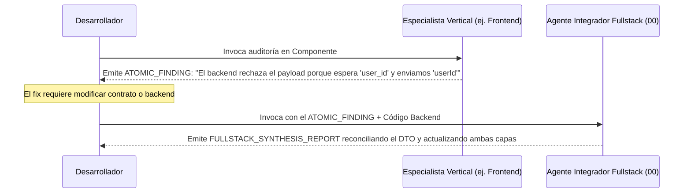

# 🚀 Manual Operativo de Invocación por Dominio (Domain Audit Playbook)

> **Guía exhaustiva para saber qué hace cada agente, cuándo activarlo, cuándo NO usarlo y cómo pasarle el contexto exacto.**

Este manual sirve como brújula para cualquier desarrollador o líder técnico que desee auditar un proyecto con el kit. Cada agente está diseñado con **visión hiper-especializada**: sabe mucho de su área y rechaza distraerse con otras capas.

---

## 🧭 1. Árbol de Decisión Rápido (Triage de Problemas)

| Si tu síntoma o necesidad es... | El agente indicado es... | Ruta en el Kit |
| :--- | :--- | :--- |
| Un formulario envía datos pero el servidor rechaza con 400 Bad Request o campos vacíos. | **00_fullstack_integrator** | `domains/00_fullstack_integrator/` |
| El proyecto tiene carpetas desordenadas, tipos duplicados o no sabes cómo estructurarlo. | **00_fullstack_integrator** | `domains/00_fullstack_integrator/` |
| Quieres auditar un módulo de frontend completo, saber si está listo para publicar o no sabes qué skill aplicar. | **skill `/frontend:audit`** | `plugins/frontend/skills/audit/` |
| La interfaz es incómoda, fea o no sabes si funciona bien en móvil, tablet y laptop (sin código). | **skill `/frontend:ux-review`** | `plugins/frontend/skills/ux-review/` |
| Estructura caótica de carpetas frontend, dependencias circulares, features acopladas. | **skill `/frontend:architecture`** | `plugins/frontend/skills/architecture/` |
| Tipos `any`, contratos de API sin tipar o sin validar, tsconfig laxo. | **skill `/frontend:typescript`** | `plugins/frontend/skills/typescript/` |
| Llamadas directas de axios en vistas, refresh token, caché, datos obsoletos, respuestas fuera de orden. | **skill `/frontend:data-fetching`** | `plugins/frontend/skills/data-fetching/` |
| La página se congela, la memoria RAM del navegador no para de subir o hay re-renders infinitos. | **skill `/frontend:state-management`** | `plugins/frontend/skills/state-management/` |
| Formularios complejos, validación Zod, prevención de doble clic y errores 422. | **skill `/frontend:forms`** | `plugins/frontend/skills/forms/` |
| Colores hardcodeados, quiebres de Dark/Light mode, variantes CVA, componentes base duplicados. | **skill `/frontend:design-system`** | `plugins/frontend/skills/design-system/` |
| Trampas de teclado, focus trap/restoration en modales, contraste WCAG, ARIA, lectores de pantalla. | **skill `/frontend:accessibility`** | `plugins/frontend/skills/accessibility/` |
| El diseño está aprobado pero se desborda en laptop 1366x768 o móvil (sin rediseñar). | **skill `/frontend:responsive-layout`** | `plugins/frontend/skills/responsive-layout/` |
| La app carga lento, los clics responden tarde, el contenido salta o el bundle no para de crecer. | **skill `/frontend:performance`** | `plugins/frontend/skills/performance/` |
| ¿SPA, SSR o SSG? Errores de hidratación, páginas que no indexan o vistas previas vacías al compartir. | **skill `/frontend:rendering-and-seo`** | `plugins/frontend/skills/rendering-and-seo/` |
| Se ve contenido protegido antes de redirigir, filtros que se pierden al recargar, botón atrás que falla. | **skill `/frontend:routing`** | `plugins/frontend/skills/routing/` |
| HTML de usuarios renderizado, tokens en localStorage, secretos en el bundle, scripts de terceros. | **skill `/frontend:security`** | `plugins/frontend/skills/security/` |
| Tests de componentes frágiles, lentos o intermitentes; qué probar y cómo en el frontend. | **skill `/frontend:testing`** | `plugins/frontend/skills/testing/` |
| Pantallas en blanco tras un error, errores de usuarios que no llegan al equipo o llegan sin contexto. | **skill `/frontend:observability`** | `plugins/frontend/skills/observability/` |
| Varios idiomas o países: textos sin traducir, plurales, fechas, monedas, RTL. | **skill `/frontend:i18n`** | `plugins/frontend/skills/i18n/` |
| CI lento o débil, builds no reproducibles, variables de entorno caóticas, lint y formato. | **skill `/frontend:tooling`** | `plugins/frontend/skills/tooling/` |
| Peticiones colgadas, endpoints sin validación, errores 500 con stack trace, respuestas que filtran campos internos. | **skill `/backend:http-layer`** | `plugins/backend/skills/http-layer/` |
| Controladores gigantes, reglas de negocio duplicadas, estados imposibles, dinero en float. | **skill `/backend:domain-logic`** | `plugins/backend/skills/domain-logic/` |
| N+1, consultas sin límite, operaciones sin transacción, sobreventa o saldos incorrectos bajo concurrencia, pool agotado. | **skill `/backend:data-access`** | `plugins/backend/skills/data-access/` |
| Faltan índices, consultas lentas en EXPLAIN, migraciones que bloquean tablas o cambios de esquema en producción. | **skill `/backend:schema-and-migrations`** | `plugins/backend/skills/schema-and-migrations/` |
| Login, sesiones, JWT, reset de contraseña, MFA o API keys. | **skill `/backend:authentication`** | `plugins/backend/skills/authentication/` |
| ¿Un usuario puede ver o modificar datos ajenos (IDOR)? Roles, permisos, aislamiento entre tenants. | **skill `/backend:authorization`** | `plugins/backend/skills/authorization/` |
| Inyecciones, SSRF, uploads, rate limiting, secretos en el repo, configuración insegura, dependencias vulnerables. | **skill `/backend:api-security`** | `plugins/backend/skills/api-security/` |
| Quieres certificar la madurez de pruebas global, coordinar el escuadrón de QA o hacer un post-mortem tras una caída. | **00_qa_director** | `domains/05_qa_testing_engineering/00_qa_director/` |
| Código difícil de testear, dependencias no inyectadas o tests sin aserciones reales. | **01_testability_and_unit_audit** | `domains/05_qa_testing_engineering/01_testability_and_unit_audit/` |
| Tests E2E rotos o intermitentes (flaky), selectores CSS frágiles o falta de validación DTO Zod. | **02_contract_and_e2e_audit** | `domains/05_qa_testing_engineering/02_contract_and_e2e_audit/` |
| Quieres simular concurrencia masiva con k6, detectar cuellos de botella y verificar SLAs p95/p99. | **03_performance_load_audit** | `domains/05_qa_testing_engineering/03_performance_load_audit/` |
| Auditar la seguridad en runtime: cabeceras CSP/HSTS, ataques de fuerza bruta en login y errores 500. | **04_dast_security_zap_audit** | `domains/05_qa_testing_engineering/04_dast_security_zap_audit/` |
| Analizar por qué siguen reapareciendo bugs (Ishikawa 5 ramas), aislar el 20% crítico (Pareto) o crear plan Kaizen. | **05_root_cause_kaizen_audit** | `domains/05_qa_testing_engineering/05_root_cause_kaizen_audit/` |

---

## 🏛️ 2. Guía Detallada Agente por Agente

---

### 🧠 DOMINIO 00: EL HUB INTEGRADOR

#### Agente: `00_fullstack_integrator` (Staff Cross-Layer Systems Architect)

* **¿Qué hace exactamente?**
  Es el **árbitro y arquitecto sistémico**. Inspecciona la frontera entre el cliente (SPA) y el servidor (API), detectando divergencias en contratos (camelCase vs snake_case, DTOs incompatibles), diagnosticando fallos en cascada E2E y diseñando la topología limpia de carpetas de todo el repositorio.
* **¿Cuándo DEBES usarlo?**
  - Cuando un flujo que involucra UI ➔ Network ➔ API ➔ Base de datos falla y no sabes en qué capa está la culpa.
  - Cuando Frontend y Backend han evolucionado por separado y sospechas que hay endpoints desfasados o rotos.
  - Cuando el repositorio es un monorock o código espagueti y necesitas una propuesta visual de reestructuración limpia sin romper producción.
* **¿Cuándo NO debes usarlo?**
  - ❌ **NO lo uses** para revisar si un botón tiene mal contraste de color (usa `/frontend:accessibility`).
  - ❌ **NO lo uses** para optimizar una consulta SQL puntual que ya identificaste como lenta (usa `/backend:data-access` o `/backend:schema-and-migrations`).
  - ❌ **NO lo uses** para revisar fugas de memoria en hooks de React o composables de Vue (usa `/frontend:state-management`).
* **¿Cómo invocarlo y qué insumos darle?**
  - **Insumos mínimos:** Ruta de la carpeta Frontend + Ruta de la carpeta Backend.
  - **Prompt sugerido:**
    ```text
    Actúa como 00_fullstack_integrator. Audita la integración entre Frontend ([ruta/frontend]) y Backend ([ruta/backend]). Identifica discrepancias de contratos, fallos E2E y propón una estructura limpia de carpetas bajo templates/FULLSTACK_SYNTHESIS_REPORT.md.
    ```

---

### 🎨 DOMINIO 01: FRONTEND (plugin `frontend`)

Todos los especialistas del frontend son ahora **skills de Claude Code** en `plugins/frontend/skills/`. Cada una tiene dos modos (construir/diseñar y auditar), notas por stack (Vue, React, Angular) cuando aplica, y comparte con las demás la escala de severidad, el formato de informe y la matriz de 13 viewports (`plugins/frontend/standards/`). Se invocan con `/frontend:<skill>` o se activan solas cuando la petición encaja con su descripción. Catálogo completo: [`plugins/frontend/README.md`](../plugins/frontend/README.md).

| Skill | Qué cubre | Sustituye a |
| :--- | :--- | :--- |
| `/frontend:ux-review` | Crítica UI/UX sin código: jerarquía, densidad, coherencia visual, responsive percibido, estados, flujos, Antes/Después. También diseña la UX de pantallas nuevas. | `01_senior_design_critic` |
| `/frontend:architecture` | Estructura por features, límites entre módulos, dependencias circulares, monorepo, ADRs. | parte de `01_arch_and_network` |
| `/frontend:typescript` | tsconfig estricto, eliminar `any`, contratos de API tipados y validados, uniones discriminadas. | parte de `01_arch_and_network` |
| `/frontend:data-fetching` | Cliente HTTP, interceptores, refresh token single-flight, cancelación, TanStack Query, tiempo real. | parte de `01_arch_and_network` |
| `/frontend:state-management` | Dónde vive cada dato, stores, fugas de memoria, reactividad, re-renders, estado en SSR. | `02_state_and_reactivity` |
| `/frontend:forms` | Schemas, doble envío, idempotencia, errores 422 por campo, wizards, listas dinámicas, archivos. | `03_forms_and_data_flow` |
| `/frontend:design-system` | Tokens en tres niveles, temas, componentes base, variantes (CVA), matriz de estados, resiliencia de layout. | `04_design_system_and_styling` |
| `/frontend:accessibility` | WCAG 2.2 AA: teclado, foco, ARIA (patrones APG), lectores de pantalla, contraste, pruebas con axe y manuales. | `05_accessibility_and_wcag` |
| `/frontend:responsive-layout` | Correcciones de layout sin rediseñar en 13 viewports con jerarquía de 5 niveles. | `06_responsive_layout_specialist` |
| `/frontend:performance` | Core Web Vitals (LCP, INP, CLS), bundle y code splitting, imágenes, fuentes, terceros, presupuestos en CI. | nueva |
| `/frontend:rendering-and-seo` | CSR/SSR/SSG/ISR, hidratación, aislamiento en SSR, metadatos, canonical, sitemap, datos estructurados, 404 reales. | nueva |
| `/frontend:routing` | Rutas tipadas, lazy loading, guards (y sus límites), retorno seguro tras login, estado en la URL validado, 404/403. | nueva |
| `/frontend:security` | XSS y sanitización, sesión y tokens, CSRF, secretos en el bundle, CSP, postMessage, dependencias. | nueva |
| `/frontend:testing` | Testing Library, MSW, tests de formularios, stores y guards, estabilidad, regresión visual. E2E queda en QA. | nueva |
| `/frontend:observability` | Capas de manejo de errores, UX de error, Sentry (source maps, releases, sin datos personales), RUM, trazas con el backend, desfase de versión. | nueva |
| `/frontend:i18n` | Claves y ICU, sin concatenar, formatos con `Intl`, zonas horarias, detección de idioma, URLs por idioma, RTL, flujo de traducción. | nueva |
| `/frontend:tooling` | Node y lockfile fijados, scripts estándar, entorno validado, ESLint/Prettier/Biome, hooks, CI, source maps, despliegue estático. | nueva |
| `/frontend:audit` | Orquestador: triage, elige una de 11 rutas, aplica las skills, deduplica, puntúa por área y global (0–100) y propone (o ejecuta) la remediación por lotes. | `00_frontend_director` |

---
### ⚙️ DOMINIO 02: BACKEND (plugin `backend`, incluye base de datos)

Los antiguos agentes `02_backend/api_rest_gateway`, `02_backend/domain_business_logic` y `03_database/query_performance_indexer` son ahora **skills de Claude Code** en `plugins/backend/skills/`, con modos construir y auditar y notas para Node/TypeScript, Python y Java/Spring. Se invocan con `/backend:<skill>`. Catálogo y hoja de ruta: [`plugins/backend/README.md`](../plugins/backend/README.md).

| Skill | Qué cubre | Sustituye a |
| :--- | :--- | :--- |
| `/backend:http-layer` | Validación en la frontera, mass assignment, DTOs de salida, pipeline de middlewares, error handler único, límites, timeouts, CORS, graceful shutdown. | `api_rest_gateway` |
| `/backend:domain-logic` | Casos de uso, invariantes, máquinas de estado, value objects (dinero), errores de dominio, efectos tras el commit. | `domain_business_logic` |
| `/backend:data-access` | N+1, límites y paginación por cursor, transacciones y aislamiento, concurrencia (atómicas, optimista, pesimista, upsert), pool y timeouts. | `query_performance_indexer` (parte de código) + transacciones de `domain_business_logic` |
| `/backend:schema-and-migrations` | Tipos y constraints, índices desde las consultas, EXPLAIN, migraciones sin downtime (expand/contract, índices concurrentes, backfills por lotes). | `query_performance_indexer` (índices) |

---
### 🛡️ SEGURIDAD DE SERVIDOR (plugin `backend`)

El antiguo agente `04_security/owasp_threat_hunter` se ha repartido en tres skills del plugin `backend` que cubren el OWASP API Security Top 10 (2023). La seguridad del cliente (XSS, CSP, tokens en el navegador) está en `/frontend:security`.

| Skill | Qué cubre |
| :--- | :--- |
| `/backend:authentication` | Sesiones vs tokens, verificación de JWT, refresh rotativo con detección de reutilización, OIDC, hashing (Argon2id/bcrypt), login sin enumeración y con límites, reset de contraseña, MFA, API keys. |
| `/backend:authorization` | RBAC/ABAC/ReBAC, autorización por objeto (IDOR), por función y por propiedad, multi-tenant con row-level security, listados y exportaciones, tests de matriz de permisos. |
| `/backend:api-security` | Inyecciones (SQL, NoSQL, comandos, rutas, plantillas), consumo de recursos y rate limiting, flujos de negocio, SSRF, uploads, deserialización, secretos, configuración de producción, inventario, dependencias. |

---
### 🧪 DOMINIO 05: QA, TESTABILITY & QUALITY ENGINEERING

El dominio de Calidad de Software, Arquitectura de Pruebas y Resiliencia está liderado por **`00_qa_director`**, quien coordina a 5 especialistas verticales distribuidos en niveles de código (Shift-Left), runtime operativo (Shift-Right) y mejora continua:

#### 👑 Agente: `00_qa_director` (Head of Quality Engineering & SDET Director)
* **¿Qué hace exactamente?**
  Es el **director y estratega supremo de calidad**. Evalúa la madurez de pruebas del repositorio, realiza el triage de problemas complejos, selecciona y activa las rutas canónicas del `ROUTING_PLAYBOOK.md` (Post-Mortem, Pre-Release Gate, Anti-Flakiness CI/CD o Resiliencia Operativa), y consolida el veredicto cuantificado emitiendo `templates/QA_MATURITY_SCORECARD_TEMPLATE.md` (0 a 100 puntos).
* **¿Cuándo DEBES usarlo?**
  - Cuando no sabes qué tipo de prueba o especialista necesitas para resolver un problema de calidad.
  - Antes de un pase mayor a producción para certificar el estado de las suites, contratos y rendimiento.
  - Tras caídas graves o regresiones repetidas para coordinar el análisis forense y el plan de blindaje.
* **¿Cuándo NO debes usarlo?**
  - ❌ **NO lo uses** si ya sabes exactamente qué archivo necesitas refactorizar para inyección de dependencias (usa `01_testability_and_unit_audit`).
  - ❌ **NO lo uses** si solo buscas escribir un script k6 para un endpoint puntual (usa `03_performance_load_audit`).
* **Prompt sugerido:**
  ```text
  Actúa como 05_qa_testing_engineering/00_qa_director. Audita la madurez de pruebas y calidad en [ruta/proyecto]. Aplica tu ROUTING_PLAYBOOK.md, activa la ruta necesaria y emite el scorecard bajo templates/QA_MATURITY_SCORECARD_TEMPLATE.md.
  ```

---

#### 1. `01_testability_and_unit_audit` (Testability & Unit Specialist)
* **¿Qué hace exactamente?** Audita la testabilidad del código: acoplamiento rígido, instanciaciones directas con `new`, dependencias no inyectadas, funciones impuras y tests unitarios sin aserciones reales (*assertion-free* o tautológicos).
* **¿Cuándo DEBES usarlo?** Al crear o refactorizar servicios de lógica de negocio, o cuando las métricas de cobertura parecen altas pero hay bugs frecuentes.
* **Insumos mínimos:** Archivo de servicio o controlador + suite de tests unitarios asociada.
* **Prompt sugerido:**
  ```text
  Actúa como 05_qa_testing_engineering/01_testability_and_unit_audit. Audita [ruta/src/services/billing.service.ts] y sus pruebas unitarias. Diagnostica acoplamiento a infraestructura y emite el código refactorizado con DI y suite determinista bajo templates/ATOMIC_FINDING_TEMPLATE.md.
  ```

#### 2. `02_contract_and_e2e_audit` (Contract & E2E Specialist)
* **¿Qué hace exactamente?** Audita suites Playwright/Cypress y contratos API: detecta selectores frágiles (XPath, clases CSS), esperas fijas (`sleep`), ausencia de validación DTO en runtime (Zod) y omisión del análisis de valores límite (BVA).
* **¿Cuándo DEBES usarlo?** Cuando las suites de CI fallan aleatoriamente (*flaky tests*) o cuando el frontend asume campos del backend sin validación.
* **Insumos mínimos:** Archivo de prueba E2E (`.spec.ts`) o cliente API frontend (`client.ts`).
* **Prompt sugerido:**
  ```text
  Actúa como 05_qa_testing_engineering/02_contract_and_e2e_audit. Audita [ruta/e2e/checkout.spec.ts]. Erradica esperas fijas, reemplaza selectores por getByRole y añade validación de contrato bajo templates/ATOMIC_FINDING_TEMPLATE.md.
  ```

#### 3. `03_performance_load_audit` (Performance & Load Specialist)
* **¿Qué hace exactamente?** Audita la resiliencia de endpoints ante estrés concurrente, agotamiento de pools de BD, bloqueos del Event Loop y ausencia de SLAs p95/p99. Genera scripts de prueba k6 ejecutables con escenarios escalonados.
* **¿Cuándo DEBES usarlo?** En endpoints transaccionales críticos (pagos, búsquedas complejas, checkout) antes de campañas de alto tráfico.
* **Insumos mínimos:** Controlador o servicio backend + SLA deseado (ej. 300 VUs, p95 < 400ms).
* **Prompt sugerido:**
  ```text
  Actúa como 05_qa_testing_engineering/03_performance_load_audit. Audita [ruta/backend/src/controllers/payment.controller.ts]. Genera un script de prueba de carga k6 completo y analiza cuellos de botella bajo templates/ATOMIC_FINDING_TEMPLATE.md.
  ```

#### 4. `04_dast_security_zap_audit` (DAST & OWASP ZAP Specialist)
* **¿Qué hace exactamente?** Audita la seguridad dinámica en tiempo de ejecución: cabeceras de respuesta HTTP (CSP, HSTS, X-Frame-Options), protección contra fuerza bruta (rate-limiting) en login, cookies de sesión y fuga de trazas en errores 500.
* **¿Cuándo DEBES usarlo?** Al auditar una instancia local o de staging en ejecución, o revisar middlewares de seguridad y servidor web.
* **Insumos mínimos:** URL del servicio o archivo de servidor/middlewares (`server.ts`, `middleware.ts`).
* **Prompt sugerido:**
  ```text
  Actúa como 05_qa_testing_engineering/04_dast_security_zap_audit. Audita las cabeceras y control de abuso en [URL_O_ARCHIVO]. Entrega PoC con cURL y configuración de bastionado bajo templates/ATOMIC_FINDING_TEMPLATE.md.
  ```

#### 5. `05_root_cause_kaizen_audit` (Root Cause & Kaizen Specialist)
* **¿Qué hace exactamente?** Realiza análisis forense de causa raíz sobre historiales de incidentes o commits de fix. Construye el Diagrama de Ishikawa en 5 ramas, aplica el filtro de Pareto 80/20 y diseña la matriz Kaizen con Quick Wins inmediatos y reformas estructurales.
* **¿Cuándo DEBES usarlo?** Ante incidentes graves en producción, regresiones recurrentes o para post-mortems de ingeniería.
* **Insumos mínimos:** Historial de git log de correcciones, descripción de un incidente o módulo con bugs repetitivos.
* **Prompt sugerido:**
  ```text
  Actúa como 05_qa_testing_engineering/05_root_cause_kaizen_audit. Analiza el historial de fallos en [CONTEXTO_INCIDENTE]. Elabora el Diagrama de Ishikawa, la tabla de Pareto 80/20 y la matriz Kaizen bajo templates/KAIZEN_ACTION_TEMPLATE.md.
  ```

---

## 🔁 3. Protocolo de Escalación: Del Especialista al Integrador

Si durante la auditoría un especialista vertical detecta que el problema no puede solucionarse en su propia capa:



1. El especialista emite su **`ATOMIC_FINDING_TEMPLATE.md`**.
2. Si el hallazgo indica que la causa raíz reside en la contraparte (o requiere coordinar ambas), ejecutas al **`00_fullstack_integrator`**.
3. Le pasas como insumo el reporte del especialista junto con la ruta de la contraparte.
4. El Integrador emite el **`FULLSTACK_SYNTHESIS_REPORT.md`** con la solución definitiva de extremo a extremo.
