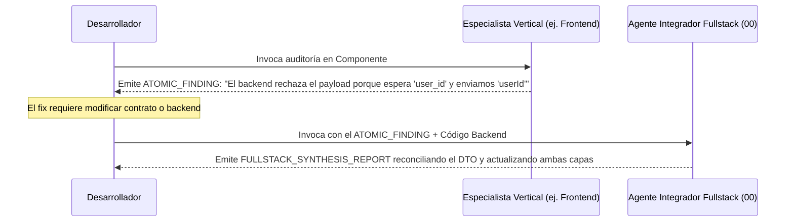

# 🚀 Manual Operativo de Invocación por Dominio (Domain Audit Playbook)

> **Guía exhaustiva para saber qué hace cada agente, cuándo activarlo, cuándo NO usarlo y cómo pasarle el contexto exacto.**

Este manual sirve como brújula para cualquier desarrollador o líder técnico que desee auditar un proyecto con el kit. Cada agente está diseñado con **visión hiper-especializada**: sabe mucho de su área y rechaza distraerse con otras capas.

---

## 🧭 1. Árbol de Decisión Rápido (Triage de Problemas)

| Si tu síntoma o necesidad es... | El agente indicado es... | Ruta en el Kit |
| :--- | :--- | :--- |
| Un formulario envía datos pero el servidor rechaza con 400 Bad Request o campos vacíos. | **00_fullstack_integrator** | `domains/00_fullstack_integrator/` |
| El proyecto tiene carpetas desordenadas, tipos duplicados o no sabes cómo estructurarlo. | **00_fullstack_integrator** | `domains/00_fullstack_integrator/` |
| Quieres auditar un módulo de frontend completo y coordinar a los especialistas. | **00_frontend_director** | `domains/01_frontend/00_frontend_director/` |
| La interfaz es incómoda, fea o no sabes si funciona bien en 10 resoluciones (CERO CÓDIGO). | **01_senior_design_critic** | `domains/01_frontend/ui_ux_experience/01_senior_design_critic/` |
| Estructura caótica de carpetas frontend, dependencias circulares, features acopladas. | **skill `/frontend:architecture`** | `plugins/frontend/skills/architecture/` |
| Tipos `any`, contratos de API sin tipar o sin validar, tsconfig laxo. | **skill `/frontend:typescript`** | `plugins/frontend/skills/typescript/` |
| Llamadas directas de axios en vistas, refresh token, caché, datos obsoletos, respuestas fuera de orden. | **skill `/frontend:data-fetching`** | `plugins/frontend/skills/data-fetching/` |
| La página se congela, la memoria RAM del navegador no para de subir o hay re-renders infinitos. | **skill `/frontend:state-management`** | `plugins/frontend/skills/state-management/` |
| Formularios complejos, validación Zod, prevención de doble clic y errores 422. | **skill `/frontend:forms`** | `plugins/frontend/skills/forms/` |
| Colores hardcodeados, quiebres de Dark/Light mode, variantes CVA o layout widescreen roto. | **04_design_system_and_styling** | `domains/01_frontend/engineering/04_design_system_and_styling/` |
| Trampas de teclado, focus trap/restoration en modales, ratios de contraste WCAG y ARIA. | **05_accessibility_and_wcag** | `domains/01_frontend/engineering/05_accessibility_and_wcag/` |
| El diseño está aprobado pero se desborda en laptop 1366x768 o mobile (Tailwind/CSS, CERO rediseño). | **06_responsive_layout_specialist** | `domains/01_frontend/engineering/06_responsive_layout_specialist/` |
| Peticiones quedan colgadas sin responder (timeout) o no hay validación de tipos en el body. | **api_rest_gateway** | `domains/02_backend/api_rest_gateway/` |
| Controladores gigantes de 800 líneas, cálculos de saldo sin transacciones ACID. | **domain_business_logic** | `domains/02_backend/domain_business_logic/` |
| Una consulta tarda 2 segundos, sospechas de consultas N+1 en bucles o faltan índices. | **query_performance_indexer** | `domains/03_database/query_performance_indexer/` |
| Quieres verificar si un usuario puede ver facturas ajenas (IDOR), inyecciones SQL o secrets en repo. | **owasp_threat_hunter** | `domains/04_security/owasp_threat_hunter/` |
| Quieres certificar la madurez de pruebas global, coordinar el escuadrón de QA o hacer un post-mortem tras una caída. | **00_qa_director** | `domains/05_qa_testing_engineering/00_qa_director/` |
| Código difícil de testear, dependencias no inyectadas o tests sin aserciones reales. | **01_testability_and_unit_audit** | `domains/05_qa_testing_engineering/01_testability_and_unit_audit/` |
| Tests E2E rotos o intermitentes (flaky), selectores CSS frágiles o falta de validación DTO Zod. | **02_contract_and_e2e_audit** | `domains/05_qa_testing_engineering/02_contract_and_e2e_audit/` |
| Quieres simular concurrencia masiva con k6, detectar cuellos de botella y verificar SLAs p95/p99. | **03_performance_load_audit** | `domains/05_qa_testing_engineering/03_performance_load_audit/` |
| Auditar la seguridad en runtime: cabeceras CSP/HSTS, ataques de fuerza bruta en login y errores 500. | **04_dast_security_zap_audit** | `domains/05_qa_testing_engineering/04_dast_security_zap_audit/` |
| Analizar por qué siguen reapareciendo bugs (Ishikawa 5 ramas), aislar el 20% crítico (Pareto) o crear plan Kaizen. | **05_root_cause_kaizen_audit** | `domains/05_qa_testing_engineering/05_root_cause_kaizen_audit/` |

---

## 🏛️ 2. Guía Detallada Agente por Agente

---

### 🧠 DOMINIO 00: EL HUB INTEGRADOR

#### Agente: `00_fullstack_integrator` (Staff Cross-Layer Systems Architect)

* **¿Qué hace exactamente?**
  Es el **árbitro y arquitecto sistémico**. Inspecciona la frontera entre el cliente (SPA) y el servidor (API), detectando divergencias en contratos (camelCase vs snake_case, DTOs incompatibles), diagnosticando fallos en cascada E2E y diseñando la topología limpia de carpetas de todo el repositorio.
* **¿Cuándo DEBES usarlo?**
  - Cuando un flujo que involucra UI ➔ Network ➔ API ➔ Base de datos falla y no sabes en qué capa está la culpa.
  - Cuando Frontend y Backend han evolucionado por separado y sospechas que hay endpoints desfasados o rotos.
  - Cuando el repositorio es un monorock o código espagueti y necesitas una propuesta visual de reestructuración limpia sin romper producción.
* **¿Cuándo NO debes usarlo?**
  - ❌ **NO lo uses** para revisar si un botón tiene mal contraste de color (usa `05_accessibility_and_wcag`).
  - ❌ **NO lo uses** para optimizar una consulta SQL puntual que ya identificaste como lenta (usa `query_performance_indexer`).
  - ❌ **NO lo uses** para revisar fugas de memoria en hooks de React o composables de Vue (usa `/frontend:state-management`).
* **¿Cómo invocarlo y qué insumos darle?**
  - **Insumos mínimos:** Ruta de la carpeta Frontend + Ruta de la carpeta Backend.
  - **Prompt sugerido:**
    ```text
    Actúa como 00_fullstack_integrator. Audita la integración entre Frontend ([ruta/frontend]) y Backend ([ruta/backend]). Identifica discrepancias de contratos, fallos E2E y propón una estructura limpia de carpetas bajo templates/FULLSTACK_SYNTHESIS_REPORT.md.
    ```

---

### 🎨 DOMINIO 01: ESCUADRÓN COLABORATIVO FRONTEND

El Dominio Frontend está dividido en **dos subdominios especializados** bajo la dirección de `00_frontend_director`:
1. **`ui_ux_experience/` (Outside-In / CERO CÓDIGO):** Evaluación visual, ergonomía cognitiva, responsive en 10 resoluciones y críticas de diseño sin inspeccionar código fuente.
2. **`engineering/` (Inside-Out / Código y Arquitectura):** Calidad técnica, tipado, reactividad, validación de formularios, arquitectura de componentes y cumplimiento WCAG a nivel DOM.

---

#### Agente Director: `00_frontend_director` (Frontend Engineering Director)

* **¿Qué hace exactamente?**
  Es el **Director Rector del dominio**. No audita líneas aisladas; evalúa tu objetivo, selecciona la ruta de auditoría (`ROUTING_PLAYBOOK.md`), activa a los especialistas en el orden exacto (Ruta 0 UX-First, Ruta 1 Crítica Visual pura, Rutas 2-6 de Ingeniería), vigila que los handoffs cumplan calidad y emite el dictamen consolidado del frontend.
* **¿Cuándo DEBES usarlo?**
  - Para auditar una pantalla, módulo o feature completa de principio a fin combinando visión de producto/diseño e ingeniería.
  - Cuando quieras que el equipo de UX e ingenieros colaboren sin tener que coordinarlos manualmente.
* **¿Cuándo NO debes usarlo?**
  - ❌ **NO lo uses** si solo quieres auditar una tarea micro aislada de 2 minutos (invoca al especialista directo).
* **¿Cómo invocarlo y qué insumos darle?**
  - **Insumos mínimos:** Ruta del módulo frontend + objetivo de la auditoría.
  - **Prompt sugerido:**
    ```text
    Actúa como 00_frontend_director. Audita el módulo en [ruta/modulo]. Selecciona la ruta de auditoría adecuada, orquesta a tus especialistas (UX + Engineering) usando INTER_AGENT_HANDOFF_MEMO.md y consolida el dictamen final.
    ```

---

### 👁️ Subdominio: `ui_ux_experience/` (Experiencia de Usuario & Crítica Visual)

#### Agente: `01_senior_design_critic` (Senior UI/UX Designer, Design Critic & Responsive Design Specialist)

* **¿Qué hace exactamente?**
  Audita la **interfaz real que experimenta el usuario** con mentalidad hipercrítica de diseñador senior. **NO toca código ni revisa TypeScript ni sintaxis**. Evalúa jerarquía visual, carga cognitiva, consistencia tipográfica y cromática, microcopia, affordance, fricción interactiva y **comportamiento responsive estricto en 10 resoluciones** (móviles 320px/375px/390px/414px, tablets 768px/1024px, laptops 1280px/1366px, desktop 1440px/1920px). Para cada defecto visual, entrega una propuesta concreta **"Antes vs Después"**.
* **¿Cuándo DEBES usarlo?**
  - Quieres saber si una pantalla es cómoda, intuitiva, limpia y visualmente profesional antes de escribir o reescribir código.
  - Sospechas que una vista está sobrecargada, con tablas que desbordan, tipografía ilegible o botones confusos.
  - Quieres una auditoría rigurosa de adaptación responsive en los 10 viewports estándar.
  - Necesitas una guía de rediseño visual para que luego el equipo de ingeniería la implemente.
* **¿Cuándo NO debes usarlo?**
  - ❌ **NO lo uses** para revisar si un hook tiene memory leak o si un store pierde reactividad (usa `/frontend:state-management`).
  - ❌ **NO lo uses** para revisar contratos de red, axios o tipado TypeScript (usa `/frontend:data-fetching` o `/frontend:typescript`).
  - ❌ **NO lo uses** para revisar si un modal tiene focus trap en el DOM (usa `05_accessibility_and_wcag`).
* **🤝 Interacción con Ingeniería:**
  - Cuando detecta que un problema visual se debe a componentes atómicos inconsistentes, emite una nota en su handoff memo hacia `04_design_system_and_styling`.
  - Si detecta barreras de contraste severas o botones táctiles menores a 44px, alerta a `05_accessibility_and_wcag`.
* **¿Cómo invocarlo?**
  - `domains/01_frontend/ui_ux_experience/01_senior_design_critic/ONE_SHOT_PROMPT.md`

---

### 🧩 Skills del plugin `frontend` (fundamentos de ingeniería)

Los antiguos agentes `01_arch_and_network`, `02_state_and_reactivity` y `03_forms_and_data_flow` se han convertido en skills de Claude Code dentro de `plugins/frontend/skills/`. Cada skill tiene dos modos (**construir** y **auditar**), notas por stack (Vue, React, Angular) y se invoca con `/frontend:<skill>` o de forma automática cuando la petición encaja con su descripción. El catálogo completo está en [`plugins/frontend/README.md`](../plugins/frontend/README.md).

| Skill | Qué cubre | Sustituye a |
| :--- | :--- | :--- |
| `/frontend:architecture` | Estructura por features, límites entre módulos, dependencias circulares, monorepo, ADRs. | parte de `01_arch_and_network` |
| `/frontend:typescript` | tsconfig estricto, eliminar `any`, contratos de API tipados y validados, uniones discriminadas. | parte de `01_arch_and_network` |
| `/frontend:data-fetching` | Cliente HTTP, interceptores, refresh token single-flight, cancelación, TanStack Query, tiempo real. | parte de `01_arch_and_network` |
| `/frontend:state-management` | Dónde vive cada dato, stores, fugas de memoria, reactividad, re-renders, estado en SSR. | `02_state_and_reactivity` |
| `/frontend:forms` | Schemas, doble envío, idempotencia, errores 422 por campo, wizards, listas dinámicas, archivos. | `03_forms_and_data_flow` |

---

### 💻 Subdominio: `engineering/` (agentes pendientes de migrar)

---

#### Agente: `04_design_system_and_styling` (Lead Design System & UI Architecture Engineer)

* **¿Qué hace exactamente?**
  Audita la **arquitectura técnica visual y consistencia de componentes en código**: tokens de diseño en CSS/Tailwind, coherencia en Dark/Light mode, variantes polimórficas (CVA), matriz completa de estados (`hover`, `active`, `focus-visible`, `disabled`, `loading`), resiliencia de layout (widescreen, prevención de CLS y desborde de textos largos) y optimización de SVGs/animaciones por GPU.
* **¿Cuándo DEBES usarlo?**
  - Para auditar componentes base atómicos (`BaseButton`, `BaseInput`, `BaseModal`, `BaseBadge`, `BaseCard`).
  - Cuando detectes valores hexadecimales `#...` o medidas arbitrarias hardcodeadas en CSS/style.
  - Cuando el modo oscuro rompe la legibilidad o deja textos invisibles.
  - Para verificar que botones e inputs soporten todos los estados interactivos sin deformarse.
* **¿Cuándo NO debes usarlo?**
  - ❌ **NO lo uses** para auditar lectores de pantalla o cumplimiento estricto WCAG (usa `05_accessibility_and_wcag`).
  - ❌ **NO lo uses** para juzgar intuitividad de flujos sin mirar código (usa `01_senior_design_critic`).
* **🤝 Interacción con Accesibilidad y Crítica Visual:**
  - Recibe insumos de `01_senior_design_critic` con solicitudes de estandarización visual.
  - Si auditas un componente compuesto interactivo (Modal, Dropdown, Tabs) y notas que carece de navegación por teclado o roles ARIA, emites una nota en tu handoff memo solicitando la intervención de `05_accessibility_and_wcag`.
* **¿Cómo invocarlo?**
  - `domains/01_frontend/engineering/04_design_system_and_styling/ONE_SHOT_PROMPT.md`

---

#### Agente: `05_accessibility_and_wcag` (Principal Web Accessibility Engineer - WCAG 2.1/2.2 AA)

* **¿Qué hace exactamente?**
  Audita de forma forense la **inclusión digital, lectores de pantalla y conformidad legal WCAG en código/DOM**: navegación 100% por teclado, focus traps y focus restoration al cerrar modales con `Escape`, ratios de contraste (4.5:1 texto, 3:1 UI), árbol ARIA (`aria-expanded`, `aria-live` en regiones activas), formularios con labels y errores asociados (`aria-describedby`), tamaño mínimo táctil en móvil (24x24px / 44x44px) y `@media (prefers-reduced-motion)`.
* **¿Cuándo DEBES usarlo?**
  - Antes de liberar un release público para certificar legalmente cumplimiento de accesibilidad.
  - Para auditar la experiencia con lectores de pantalla (NVDA, JAWS, VoiceOver).
  - Cuando modales o drawers pierden el foco al cerrarse o no se pueden operar con teclado.
  - Para verificar que los mensajes de error dinámicos sean anunciados a usuarios con discapacidad visual.
* **¿Cuándo NO debes usarlo?**
  - ❌ **NO lo uses** para revisar la modularización de carpetas o cliente Axios.
  - ❌ **NO lo uses** para depurar lógica de cálculo o mutaciones de stores.
* **🤝 Interacción con Design System:**
  - Si detectas que un contraste de color no cumple (ej. 3.2:1) o que un botón táctil mide menos de 44px, emites un memo hacia `04_design_system_and_styling` para que ajuste el token de color o el padding del componente base.
* **¿Cómo invocarlo?**
  - `domains/01_frontend/engineering/05_accessibility_and_wcag/ONE_SHOT_PROMPT.md`

---

#### Agente: `06_responsive_layout_specialist` (Senior Responsive Layout & CSS Specialist)

* **¿Qué hace exactamente?**
  Audita y **corrige directamente en código (Tailwind CSS, Vue 3, CSS moderno)** el comportamiento responsive en **13 viewports obligatorios** (desde 320×568 hasta 1920×1080), con especial énfasis en alturas reducidas como laptops de `1366×768` y `1280×720`.
  > **🛡️ REGLA FUNDAMENTAL: NO REDISEÑAR.** El diseño visual ya fue aprobado; tiene prohibido cambiar colores, tipografías, jerarquías o componentes por gusto. Aplica una jerarquía estricta de 5 niveles (cajas nativas ➔ variantes Tailwind ➔ fluid clamp ➔ estructura mínima ➔ último recurso).
* **¿Cuándo DEBES usarlo?**
  - El diseño visual ya está aprobado por el cliente o producto, pero se desborda en ciertas pantallas.
  - Aparece scroll horizontal accidental en la ventana completa al achicar el navegador.
  - Modales o drawers quedan cortados verticalmente en monitores corporativos de 1366×768.
  - Tablas anchas que rompen el layout general en tablet o móvil.
  - Formularios que necesitan transicionar limpiamente de 4 a 2 y a 1 columna.
* **¿Cuándo NO debes usarlo?**
  - ❌ **NO lo uses** para criticar si la pantalla es bonita o intuitiva sin mirar código (usa `01_senior_design_critic`).
  - ❌ **NO lo uses** para rediseñar la paleta de colores o crear un nuevo Design System (usa `04_design_system_and_styling`).
  - ❌ **NO lo uses** para depurar memoria de stores o composables (usa `/frontend:state-management`).
* **🤝 Interacción con Crítica de Diseño y A11y:**
  - Recibe insumos de `01_senior_design_critic` cuando este detecta desbordes en móvil, y aplica los fixes en código sin alterar la identidad visual.
  - Garantiza el criterio WCAG 1.4.10 (Reflow a 320px sin scroll horizontal global) y touch targets mínimos de 44px en coordinación con `05_accessibility_and_wcag`.
* **¿Cómo invocarlo?**
  - `domains/01_frontend/engineering/06_responsive_layout_specialist/ONE_SHOT_PROMPT.md`

---

### ⚙️ DOMINIO 02: BACKEND SPECIALISTS

#### Agente: `api_rest_gateway` (HTTP Routing & Perimetral Security)

* **¿Qué hace exactamente?**
  Audita los routers de Express/Fastify/NestJS, middlewares perimetrales, validación estricta de payloads (Zod, Joi), rate limiting, cabeceras de seguridad y manejo global de errores HTTP.
* **¿Cuándo DEBES usarlo?**
  - Quieres verificar si tus endpoints están blindados contra payloads malformados o inyecciones de campos no permitidos.
  - Clientes reportan timeouts aleatorios (middlewares que no invocan `next()`).
  - Las respuestas de error devuelven formatos dispares o filtran stack traces de Node.js en producción.
* **¿Cuándo NO debes usarlo?**
  - ❌ **NO lo uses** para auditar cálculos matemáticos o reglas complejas de facturación (usa `domain_business_logic`).
  - ❌ **NO lo uses** para optimizar queries SQL (usa `query_performance_indexer`).
* **¿Cómo invocarlo y qué insumos darle?**
  - **Insumos mínimos:** Archivos de rutas (`routes.ts`), middlewares (`middlewares/`) y esquemas de validación.
  - **Prompt sugerido:**
    ```text
    Actúa como 02_backend/api_rest_gateway. Audita las rutas en [ruta/backend/routes] y middlewares. Revisa validación perimetral de esquemas Zod, rate limiting y el error handler centralizado bajo templates/ATOMIC_FINDING_TEMPLATE.md.
    ```

---

#### Agente: `domain_business_logic` (Domain Architecture & Clean Code)

* **¿Qué hace exactamente?**
  Audita los servicios de aplicación y dominio, erradicando controladores obesos, garantizando transaccionalidad ACID en operaciones de múltiples pasos y asegurando que las reglas del negocio no dependan de HTTP ni del framework.
* **¿Cuándo DEBES usarlo?**
  - Tus controladores tienen más de 100 líneas y mezclan consultas SQL con lógica condicional.
  - Hay operaciones críticas (ej. cobro de orden + descuento de stock) que si fallan a la mitad dejan la base de datos corrupta.
  - Quieres desacoplar el core del negocio para poder ejecutarlo en un worker o script CLI sin levantar un servidor HTTP.
* **¿Cuándo NO debes usarlo?**
  - ❌ **NO lo uses** para revisar headers HTTP, CORS o cookies (usa `api_rest_gateway`).
  - ❌ **NO lo uses** para diseñar índices B-Tree de PostgreSQL (usa `query_performance_indexer`).
* **¿Cómo invocarlo y qué insumos darle?**
  - **Insumos mínimos:** Servicios (`services/`), controladores (`controllers/`) o módulos de dominio.
  - **Prompt sugerido:**
    ```text
    Actúa como 02_backend/domain_business_logic. Audita [ruta/backend/services/orders.service.ts]. Busca transacciones ACID ausentes, controladores con lógica de negocio indebida y violaciones a Clean Architecture bajo templates/ATOMIC_FINDING_TEMPLATE.md.
    ```

---

### 🗄️ DOMINIO 03: PERSISTENCIA Y BASE DE DATOS

#### Agente: `query_performance_indexer` (Database Reliability Engineer)

* **¿Qué hace exactamente?**
  Audita repositorios de datos, consultas SQL/ORM y migraciones DDL. Caza consultas N+1 en bucles, escaneos secuenciales (Seq Scan), consultas no SARGables (`LIKE '%abc%'`), y diseña índices B-Tree compuestos.
* **¿Cuándo DEBES usarlo?**
  - La API tarda más de 500ms en responder consultas que listan registros.
  - En logs de base de datos ves cientos de queries ejecutándose por cada petición (N+1).
  - Tienes tablas de más de 50,000 filas y sospechas que faltan índices en llaves foráneas o filtros compuestos.
* **¿Cuándo NO debes usarlo?**
  - ❌ **NO lo uses** para revisar la interfaz gráfica o llamadas de Axios.
  - ❌ **NO lo uses** para auditar permisos de usuario o autenticación JWT (usa `owasp_threat_hunter`).
* **¿Cómo invocarlo y qué insumos darle?**
  - **Insumos mínimos:** Archivos de repositorio (`repositories/`), migraciones DDL (`migrations/` o `schema.sql`) o queries crudas.
  - **Prompt sugerido:**
    ```text
    Actúa como 03_database/query_performance_indexer. Audita las consultas en [ruta/backend/src/repositories] y el esquema DDL. Detecta N+1 queries y propón los índices B-Tree óptimos bajo templates/ATOMIC_FINDING_TEMPLATE.md.
    ```

---

### 🛡️ DOMINIO 04: CIBERSEGURIDAD Y APPSEC

#### Agente: `owasp_threat_hunter` (Application Security & Pentesting)

* **¿Qué hace exactamente?**
  Realiza análisis estático forense de seguridad. Detecta vulnerabilidades IDOR (modificar o ver datos de otra cuenta cambiando el ID en la URL), inyecciones SQL/NoSQL/Command, secretos o tokens hardcodeados y configuraciones laxas de JWT.
* **¿Cuándo DEBES usarlo?**
  - Antes de pasar cualquier funcionalidad o módulo nuevo a producción.
  - Al implementar un nuevo sistema de autenticación, login social o roles de usuario (RBAC).
  - Para auditar si la aplicación aísla correctamente los datos en entornos multi-inquilino (Multi-Tenant).
* **¿Cuándo NO debes usarlo?**
  - ❌ **NO lo uses** para medir rendimiento de carga o tiempos de respuesta.
  - ❌ **NO lo uses** para refactorizar nombres de variables o formateo estético de código.
* **¿Cómo invocarlo y qué insumos darle?**
  - **Insumos mínimos:** Módulos de autenticación, controladores que reciben IDs de entidades, y archivos `.env.example` o de configuración.
  - **Prompt sugerido:**
    ```text
    Actúa como 04_security/owasp_threat_hunter. Audita el módulo [ruta/backend/src/modules/billing] y su middleware de autenticación. Busca vulnerabilidades IDOR, inyecciones y fuga de secretos. Emite tu reporte bajo templates/ATOMIC_FINDING_TEMPLATE.md.
    ```

---

### 🧪 DOMINIO 05: QA, TESTABILITY & QUALITY ENGINEERING

El dominio de Calidad de Software, Arquitectura de Pruebas y Resiliencia está liderado por **`00_qa_director`**, quien coordina a 5 especialistas verticales distribuidos en niveles de código (Shift-Left), runtime operativo (Shift-Right) y mejora continua:

#### 👑 Agente: `00_qa_director` (Head of Quality Engineering & SDET Director)
* **¿Qué hace exactamente?**
  Es el **director y estratega supremo de calidad**. Evalúa la madurez de pruebas del repositorio, realiza el triage de problemas complejos, selecciona y activa las rutas canónicas del `ROUTING_PLAYBOOK.md` (Post-Mortem, Pre-Release Gate, Anti-Flakiness CI/CD o Resiliencia Operativa), y consolida el veredicto cuantificado emitiendo `templates/QA_MATURITY_SCORECARD_TEMPLATE.md` (0 a 100 puntos).
* **¿Cuándo DEBES usarlo?**
  - Cuando no sabes qué tipo de prueba o especialista necesitas para resolver un problema de calidad.
  - Antes de un pase mayor a producción para certificar el estado de las suites, contratos y rendimiento.
  - Tras caídas graves o regresiones repetidas para coordinar el análisis forense y el plan de blindaje.
* **¿Cuándo NO debes usarlo?**
  - ❌ **NO lo uses** si ya sabes exactamente qué archivo necesitas refactorizar para inyección de dependencias (usa `01_testability_and_unit_audit`).
  - ❌ **NO lo uses** si solo buscas escribir un script k6 para un endpoint puntual (usa `03_performance_load_audit`).
* **Prompt sugerido:**
  ```text
  Actúa como 05_qa_testing_engineering/00_qa_director. Audita la madurez de pruebas y calidad en [ruta/proyecto]. Aplica tu ROUTING_PLAYBOOK.md, activa la ruta necesaria y emite el scorecard bajo templates/QA_MATURITY_SCORECARD_TEMPLATE.md.
  ```

---

#### 1. `01_testability_and_unit_audit` (Testability & Unit Specialist)
* **¿Qué hace exactamente?** Audita la testabilidad del código: acoplamiento rígido, instanciaciones directas con `new`, dependencias no inyectadas, funciones impuras y tests unitarios sin aserciones reales (*assertion-free* o tautológicos).
* **¿Cuándo DEBES usarlo?** Al crear o refactorizar servicios de lógica de negocio, o cuando las métricas de cobertura parecen altas pero hay bugs frecuentes.
* **Insumos mínimos:** Archivo de servicio o controlador + suite de tests unitarios asociada.
* **Prompt sugerido:**
  ```text
  Actúa como 05_qa_testing_engineering/01_testability_and_unit_audit. Audita [ruta/src/services/billing.service.ts] y sus pruebas unitarias. Diagnostica acoplamiento a infraestructura y emite el código refactorizado con DI y suite determinista bajo templates/ATOMIC_FINDING_TEMPLATE.md.
  ```

#### 2. `02_contract_and_e2e_audit` (Contract & E2E Specialist)
* **¿Qué hace exactamente?** Audita suites Playwright/Cypress y contratos API: detecta selectores frágiles (XPath, clases CSS), esperas fijas (`sleep`), ausencia de validación DTO en runtime (Zod) y omisión del análisis de valores límite (BVA).
* **¿Cuándo DEBES usarlo?** Cuando las suites de CI fallan aleatoriamente (*flaky tests*) o cuando el frontend asume campos del backend sin validación.
* **Insumos mínimos:** Archivo de prueba E2E (`.spec.ts`) o cliente API frontend (`client.ts`).
* **Prompt sugerido:**
  ```text
  Actúa como 05_qa_testing_engineering/02_contract_and_e2e_audit. Audita [ruta/e2e/checkout.spec.ts]. Erradica esperas fijas, reemplaza selectores por getByRole y añade validación de contrato bajo templates/ATOMIC_FINDING_TEMPLATE.md.
  ```

#### 3. `03_performance_load_audit` (Performance & Load Specialist)
* **¿Qué hace exactamente?** Audita la resiliencia de endpoints ante estrés concurrente, agotamiento de pools de BD, bloqueos del Event Loop y ausencia de SLAs p95/p99. Genera scripts de prueba k6 ejecutables con escenarios escalonados.
* **¿Cuándo DEBES usarlo?** En endpoints transaccionales críticos (pagos, búsquedas complejas, checkout) antes de campañas de alto tráfico.
* **Insumos mínimos:** Controlador o servicio backend + SLA deseado (ej. 300 VUs, p95 < 400ms).
* **Prompt sugerido:**
  ```text
  Actúa como 05_qa_testing_engineering/03_performance_load_audit. Audita [ruta/backend/src/controllers/payment.controller.ts]. Genera un script de prueba de carga k6 completo y analiza cuellos de botella bajo templates/ATOMIC_FINDING_TEMPLATE.md.
  ```

#### 4. `04_dast_security_zap_audit` (DAST & OWASP ZAP Specialist)
* **¿Qué hace exactamente?** Audita la seguridad dinámica en tiempo de ejecución: cabeceras de respuesta HTTP (CSP, HSTS, X-Frame-Options), protección contra fuerza bruta (rate-limiting) en login, cookies de sesión y fuga de trazas en errores 500.
* **¿Cuándo DEBES usarlo?** Al auditar una instancia local o de staging en ejecución, o revisar middlewares de seguridad y servidor web.
* **Insumos mínimos:** URL del servicio o archivo de servidor/middlewares (`server.ts`, `middleware.ts`).
* **Prompt sugerido:**
  ```text
  Actúa como 05_qa_testing_engineering/04_dast_security_zap_audit. Audita las cabeceras y control de abuso en [URL_O_ARCHIVO]. Entrega PoC con cURL y configuración de bastionado bajo templates/ATOMIC_FINDING_TEMPLATE.md.
  ```

#### 5. `05_root_cause_kaizen_audit` (Root Cause & Kaizen Specialist)
* **¿Qué hace exactamente?** Realiza análisis forense de causa raíz sobre historiales de incidentes o commits de fix. Construye el Diagrama de Ishikawa en 5 ramas, aplica el filtro de Pareto 80/20 y diseña la matriz Kaizen con Quick Wins inmediatos y reformas estructurales.
* **¿Cuándo DEBES usarlo?** Ante incidentes graves en producción, regresiones recurrentes o para post-mortems de ingeniería.
* **Insumos mínimos:** Historial de git log de correcciones, descripción de un incidente o módulo con bugs repetitivos.
* **Prompt sugerido:**
  ```text
  Actúa como 05_qa_testing_engineering/05_root_cause_kaizen_audit. Analiza el historial de fallos en [CONTEXTO_INCIDENTE]. Elabora el Diagrama de Ishikawa, la tabla de Pareto 80/20 y la matriz Kaizen bajo templates/KAIZEN_ACTION_TEMPLATE.md.
  ```

---

## 🔁 3. Protocolo de Escalación: Del Especialista al Integrador

Si durante la auditoría un especialista vertical detecta que el problema no puede solucionarse en su propia capa:



1. El especialista emite su **`ATOMIC_FINDING_TEMPLATE.md`**.
2. Si el hallazgo indica que la causa raíz reside en la contraparte (o requiere coordinar ambas), ejecutas al **`00_fullstack_integrator`**.
3. Le pasas como insumo el reporte del especialista junto con la ruta de la contraparte.
4. El Integrador emite el **`FULLSTACK_SYNTHESIS_REPORT.md`** con la solución definitiva de extremo a extremo.
