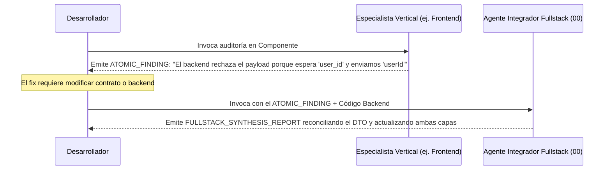

# 🚀 Manual Operativo de Invocación por Dominio (Domain Audit Playbook)

> **Guía exhaustiva para saber qué hace cada agente, cuándo activarlo, cuándo NO usarlo y cómo pasarle el contexto exacto.**

Este manual sirve como brújula para cualquier desarrollador o líder técnico que desee auditar un proyecto con el kit. Cada agente está diseñado con **visión hiper-especializada**: sabe mucho de su área y rechaza distraerse con otras capas.

---

## 🧭 1. Árbol de Decisión Rápido (Triage de Problemas)

| Si tu síntoma o necesidad es... | El agente indicado es... | Ruta en el Kit |
| :--- | :--- | :--- |
| Un formulario envía datos pero el servidor rechaza con 400 Bad Request o campos vacíos. | **00_fullstack_integrator** | `domains/00_fullstack_integrator/` |
| El proyecto tiene carpetas desordenadas, tipos duplicados o no sabes cómo estructurarlo. | **00_fullstack_integrator** | `domains/00_fullstack_integrator/` |
| La página se congela, la memoria RAM del navegador no para de subir o hay re-renders infinitos. | **state_and_reactivity** | `domains/01_frontend/state_and_reactivity/` |
| Faltan etiquetas en inputs, el contraste de color es malo o el modal no se cierra con Escape. | **ui_design_a11y** | `domains/01_frontend/ui_design_a11y/` |
| Peticiones quedan colgadas sin responder (timeout) o no hay validación de tipos en el body. | **api_rest_gateway** | `domains/02_backend/api_rest_gateway/` |
| Controladores gigantes de 800 líneas, cálculos de saldo sin transacciones ACID. | **domain_business_logic** | `domains/02_backend/domain_business_logic/` |
| Una consulta tarda 2 segundos, sospechas de consultas N+1 en bucles o faltan índices. | **query_performance_indexer** | `domains/03_database/query_performance_indexer/` |
| Quieres verificar si un usuario puede ver facturas ajenas (IDOR), inyecciones SQL o secrets en repo. | **owasp_threat_hunter** | `domains/04_security/owasp_threat_hunter/` |

---

## 🏛️ 2. Guía Detallada Agente por Agente

---

### 🧠 DOMINIO 00: EL HUB INTEGRADOR

#### Agente: `00_fullstack_integrator` (Staff Cross-Layer Systems Architect)

* **¿Qué hace exactamente?**
  Es el **árbitro y arquitecto sistémico**. Inspecciona la frontera entre el cliente (SPA) y el servidor (API), detectando divergencias en contratos (camelCase vs snake_case, DTOs incompatibles), diagnosticando fallos en cascada E2E y diseñando la topología limpia de carpetas de todo el repositorio.
* **¿Cuándo DEBES usarlo?**
  - Cuando un flujo que involucra UI ➔ Network ➔ API ➔ Base de datos falla y no sabes en qué capa está la culpa.
  - Cuando Frontend y Backend han evolucionado por separado y sospechas que hay endpoints desfasados o rotos.
  - Cuando el repositorio es un monorock o código espagueti y necesitas una propuesta visual de reestructuración limpia sin romper producción.
* **¿Cuándo NO debes usarlo?**
  - ❌ **NO lo uses** para revisar si un botón tiene mal contraste de color (usa `ui_design_a11y`).
  - ❌ **NO lo uses** para optimizar una consulta SQL puntual que ya identificaste como lenta (usa `query_performance_indexer`).
  - ❌ **NO lo uses** para revisar fugas de memoria en hooks de React o composables de Vue (usa `state_and_reactivity`).
* **¿Cómo invocarlo y qué insumos darle?**
  - **Insumos mínimos:** Ruta de la carpeta Frontend + Ruta de la carpeta Backend.
  - **Prompt sugerido:**
    ```text
    Actúa como 00_fullstack_integrator. Audita la integración entre Frontend ([ruta/frontend]) y Backend ([ruta/backend]). Identifica discrepancias de contratos, fallos E2E y propón una estructura limpia de carpetas bajo templates/FULLSTACK_SYNTHESIS_REPORT.md.
    ```

---

### 🎨 DOMINIO 01: FRONTEND SPECIALISTS

#### Agente: `state_and_reactivity` (Performance & State Specialist)

* **¿Qué hace exactamente?**
  Audita el ciclo de vida del componente y el gestor de estado (Pinia, Redux, Zustand). Caza memory leaks por listeners no removidos, desestructuración que rompe la reactividad nativa y render loops infinitos.
* **¿Cuándo DEBES usarlo?**
  - Al cambiar de ruta la pestaña del navegador se vuelve pesada o lenta tras varios minutos de uso.
  - Los componentes se renderizan 10 veces seguidas sin razón aparente.
  - Al mutar una variable el componente en pantalla no se actualiza (reactividad rota).
  - Tienes un store global gigantesco donde se guardan variables locales temporales.
* **¿Cuándo NO debes usarlo?**
  - ❌ **NO lo uses** para validar accesibilidad WCAG o estilos CSS (usa `ui_design_a11y`).
  - ❌ **NO lo uses** si la llamada HTTP devuelve 404 o 500 (el problema está en la API o en el Integrador).
* **¿Cómo invocarlo y qué insumos darle?**
  - **Insumos mínimos:** Ruta de los componentes (`.vue`, `.tsx`, `.jsx`) o de los stores (`/stores`, `/slices`).
  - **Prompt sugerido:**
    ```text
    Actúa como 01_frontend/state_and_reactivity. Audita [ruta/stores] y [ruta/views/Dashboard.vue]. Aplica tu CHECKLIST.md para cazar memory leaks, pérdida de reactividad y re-render loops. Emite tu reporte en templates/ATOMIC_FINDING_TEMPLATE.md.
    ```

---

#### Agente: `ui_design_a11y` (Design System & Accessibility Specialist)

* **¿Qué hace exactamente?**
  Audita el HTML semántico, atributos ARIA, contraste cromático WCAG 2.1 AA, navegación con teclado (foco visual, trampas en modales) y coherencia con el Design System (cero colores o estilos inline hardcodeados).
* **¿Cuándo DEBES usarlo?**
  - Antes de liberar una pantalla pública o corporativa para certificar cumplimiento de accesibilidad.
  - Para auditar una librería de componentes base (`Button`, `Modal`, `Input`, `Dropdown`).
  - Para limpiar código lleno de valores hexadecimales `#ff0000` o clases ad-hoc que violan el sistema de diseño.
* **¿Cuándo NO debes usarlo?**
  - ❌ **NO lo uses** para revisar la lógica de llamadas a APIs o autenticación.
  - ❌ **NO lo uses** para depurar problemas de sincronización de estado o renderizado condicional.
* **¿Cómo invocarlo y qué insumos darle?**
  - **Insumos mínimos:** Ruta de componentes visuales o plantillas HTML/Vue/JSX.
  - **Prompt sugerido:**
    ```text
    Actúa como 01_frontend/ui_design_a11y. Audita los componentes en [ruta/components/base]. Verifica cumplimiento WCAG 2.1 AA (contraste, foco por teclado, ARIA) y apego al design system. Emite tu reporte bajo templates/ATOMIC_FINDING_TEMPLATE.md.
    ```

---

### ⚙️ DOMINIO 02: BACKEND SPECIALISTS

#### Agente: `api_rest_gateway` (HTTP Routing & Perimetral Security)

* **¿Qué hace exactamente?**
  Audita los routers de Express/Fastify/NestJS, middlewares perimetrales, validación estricta de payloads (Zod, Joi), rate limiting, cabeceras de seguridad y manejo global de errores HTTP.
* **¿Cuándo DEBES usarlo?**
  - Quieres verificar si tus endpoints están blindados contra payloads malformados o inyecciones de campos no permitidos.
  - Clientes reportan timeouts aleatorios (middlewares que no invocan `next()`).
  - Las respuestas de error devuelven formatos dispares o filtran stack traces de Node.js en producción.
* **¿Cuándo NO debes usarlo?**
  - ❌ **NO lo uses** para auditar cálculos matemáticos o reglas complejas de facturación (usa `domain_business_logic`).
  - ❌ **NO lo uses** para optimizar queries SQL (usa `query_performance_indexer`).
* **¿Cómo invocarlo y qué insumos darle?**
  - **Insumos mínimos:** Archivos de rutas (`routes.ts`), middlewares (`middlewares/`) y esquemas de validación.
  - **Prompt sugerido:**
    ```text
    Actúa como 02_backend/api_rest_gateway. Audita las rutas en [ruta/backend/routes] y middlewares. Revisa validación perimetral de esquemas Zod, rate limiting y el error handler centralizado bajo templates/ATOMIC_FINDING_TEMPLATE.md.
    ```

---

#### Agente: `domain_business_logic` (Domain Architecture & Clean Code)

* **¿Qué hace exactamente?**
  Audita los servicios de aplicación y dominio, erradicando controladores obesos, garantizando transaccionalidad ACID en operaciones de múltiples pasos y asegurando que las reglas del negocio no dependan de HTTP ni del framework.
* **¿Cuándo DEBES usarlo?**
  - Tus controladores tienen más de 100 líneas y mezclan consultas SQL con lógica condicional.
  - Hay operaciones críticas (ej. cobro de orden + descuento de stock) que si fallan a la mitad dejan la base de datos corrupta.
  - Quieres desacoplar el core del negocio para poder ejecutarlo en un worker o script CLI sin levantar un servidor HTTP.
* **¿Cuándo NO debes usarlo?**
  - ❌ **NO lo uses** para revisar headers HTTP, CORS o cookies (usa `api_rest_gateway`).
  - ❌ **NO lo uses** para diseñar índices B-Tree de PostgreSQL (usa `query_performance_indexer`).
* **¿Cómo invocarlo y qué insumos darle?**
  - **Insumos mínimos:** Servicios (`services/`), controladores (`controllers/`) o módulos de dominio.
  - **Prompt sugerido:**
    ```text
    Actúa como 02_backend/domain_business_logic. Audita [ruta/backend/services/orders.service.ts]. Busca transacciones ACID ausentes, controladores con lógica de negocio indebida y violaciones a Clean Architecture bajo templates/ATOMIC_FINDING_TEMPLATE.md.
    ```

---

### 🗄️ DOMINIO 03: PERSISTENCIA Y BASE DE DATOS

#### Agente: `query_performance_indexer` (Database Reliability Engineer)

* **¿Qué hace exactamente?**
  Audita repositorios de datos, consultas SQL/ORM y migraciones DDL. Caza consultas N+1 en bucles, escaneos secuenciales (Seq Scan), consultas no SARGables (`LIKE '%abc%'`), y diseña índices B-Tree compuestos.
* **¿Cuándo DEBES usarlo?**
  - La API tarda más de 500ms en responder consultas que listan registros.
  - En logs de base de datos ves cientos de queries ejecutándose por cada petición (N+1).
  - Tienes tablas de más de 50,000 filas y sospechas que faltan índices en llaves foráneas o filtros compuestos.
* **¿Cuándo NO debes usarlo?**
  - ❌ **NO lo uses** para revisar la interfaz gráfica o llamadas de Axios.
  - ❌ **NO lo uses** para auditar permisos de usuario o autenticación JWT (usa `owasp_threat_hunter`).
* **¿Cómo invocarlo y qué insumos darle?**
  - **Insumos mínimos:** Archivos de repositorio (`repositories/`), migraciones DDL (`migrations/` o `schema.sql`) o queries crudas.
  - **Prompt sugerido:**
    ```text
    Actúa como 03_database/query_performance_indexer. Audita las consultas en [ruta/backend/src/repositories] y el esquema DDL. Detecta N+1 queries y propón los índices B-Tree óptimos bajo templates/ATOMIC_FINDING_TEMPLATE.md.
    ```

---

### 🛡️ DOMINIO 04: CIBERSEGURIDAD Y APPSEC

#### Agente: `owasp_threat_hunter` (Application Security & Pentesting)

* **¿Qué hace exactamente?**
  Realiza análisis estático forense de seguridad. Detecta vulnerabilidades IDOR (modificar o ver datos de otra cuenta cambiando el ID en la URL), inyecciones SQL/NoSQL/Command, secretos o tokens hardcodeados y configuraciones laxas de JWT.
* **¿Cuándo DEBES usarlo?**
  - Antes de pasar cualquier funcionalidad o módulo nuevo a producción.
  - Al implementar un nuevo sistema de autenticación, login social o roles de usuario (RBAC).
  - Para auditar si la aplicación aísla correctamente los datos en entornos multi-inquilino (Multi-Tenant).
* **¿Cuándo NO debes usarlo?**
  - ❌ **NO lo uses** para medir rendimiento de carga o tiempos de respuesta.
  - ❌ **NO lo uses** para refactorizar nombres de variables o formateo estético de código.
* **¿Cómo invocarlo y qué insumos darle?**
  - **Insumos mínimos:** Módulos de autenticación, controladores que reciben IDs de entidades, y archivos `.env.example` o de configuración.
  - **Prompt sugerido:**
    ```text
    Actúa como 04_security/owasp_threat_hunter. Audita el módulo [ruta/backend/src/modules/billing] y su middleware de autenticación. Busca vulnerabilidades IDOR, inyecciones y fuga de secretos. Emite tu reporte bajo templates/ATOMIC_FINDING_TEMPLATE.md.
    ```

---

## 🔁 3. Protocolo de Escalación: Del Especialista al Integrador

Si durante la auditoría un especialista vertical detecta que el problema no puede solucionarse en su propia capa:



1. El especialista emite su **`ATOMIC_FINDING_TEMPLATE.md`**.
2. Si el hallazgo indica que la causa raíz reside en la contraparte (o requiere coordinar ambas), ejecutas al **`00_fullstack_integrator`**.
3. Le pasas como insumo el reporte del especialista junto con la ruta de la contraparte.
4. El Integrador emite el **`FULLSTACK_SYNTHESIS_REPORT.md`** con la solución definitiva de extremo a extremo.
