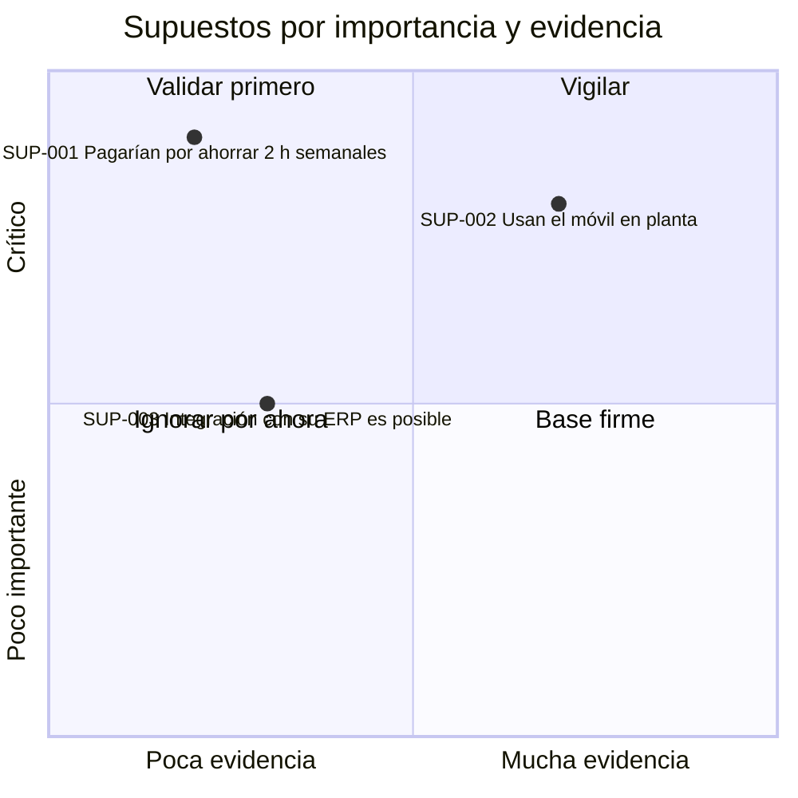

# Patrones de descubrimiento

## Problema

```text
<Segmento> necesita <resolver X> cuando <situación>, porque hoy <alternativa actual> le cuesta <tiempo, dinero, errores, frustración>.
```

- **Evidencia** del problema, de más a menos fuerte: comportamiento observado (lo pagan, lo resuelven con hojas de cálculo, se quejan en soporte) · entrevistas · opinión del promotor. Se declara cuál hay.
- **Alternativa actual:** lo que hacen hoy (otra herramienta, un proceso manual, nada). Si la respuesta es "nada" y no les duele, el problema puede no ser real.
- **Frecuencia e intensidad:** un problema diario y caro pesa más que uno anual y molesto.
- Un problema bien escrito **no menciona la solución**.

## Usuarios y segmentos

- **Segmento concreto:** "despachos contables de 2–10 personas que gestionan nóminas" mejor que "pymes".
- **Trabajos por hacer** (JTBD): `Cuando <situación>, quiero <motivación>, para <resultado esperado>`. Describen el progreso que busca el usuario, no la funcionalidad.
- **Proto-personas:** nombre, contexto, trabajos, frustraciones y alternativas actuales. Son **supuestos** (`SUP`) hasta contrastarlas con usuarios reales; se marcan así.
- **Early adopters:** el subconjunto con el problema más agudo, que probará algo incompleto. El MVP es para ellos.
- **Usuario frente a comprador:** en B2B quien usa y quien paga suelen ser distintos; los dos tienen trabajos y objeciones.

## Propuesta de valor

| Lado del usuario | Lado del producto |
| :--- | :--- |
| Trabajos por hacer | Qué hace el producto para cada trabajo |
| Frustraciones (lo que molesta, cuesta o arriesga) | Qué elimina o reduce |
| Beneficios esperados | Qué crea o mejora |

```text
Para <segmento> que <necesidad>, <producto> es <categoría> que <beneficio clave>. A diferencia de <alternativa actual>, <diferencia principal>.
```

Una propuesta que no se diferencia de la alternativa actual no da motivo para cambiar.

## Lean Canvas

| Bloque | Pregunta |
| :--- | :--- |
| 1. Problema | Los 1–3 problemas principales y las alternativas actuales |
| 2. Segmentos | Para quién; early adopters |
| 3. Propuesta única de valor | Mensaje claro de por qué es distinto y merece atención |
| 4. Solución | Las 3 capacidades mínimas que atacan cada problema |
| 5. Canales | Cómo llega a los usuarios |
| 6. Flujos de ingresos | Modelo de precio, valor por cliente |
| 7. Estructura de costes | Costes fijos y variables principales |
| 8. Métricas clave | Las acciones que indican que funciona |
| 9. Ventaja difícil de copiar | Lo que no se compra ni se copia fácilmente (puede quedar vacío al principio) |

**Herramientas internas y proyectos personales:** los bloques 5, 6 y 9 se sustituyen por:
- **5 → Adopción:** cómo empezarán a usarlo (quién lo instala, qué sustituye).
- **6 → Beneficio:** tiempo ahorrado, errores evitados, riesgo reducido.
- **9 → Restricciones:** plataforma, red, presupuesto, mantenimiento por una sola persona.

Los bloques sin información se dejan con `SUP-…` o `PRE-…`, nunca con texto inventado.

## Supuestos de mayor riesgo

Tipos: **deseabilidad** (¿lo quieren?), **viabilidad** (¿es sostenible: precio, costes, negocio?), **factibilidad** (¿se puede construir con lo que hay?), **usabilidad** (¿sabrán usarlo?).



Cada supuesto del cuadrante "Validar primero" lleva:

| Campo | Ejemplo |
| :--- | :--- |
| Supuesto | `SUP-001` Los despachos pagarían 30 €/mes por ahorrar 2 h semanales de nóminas |
| Experimento | 8 entrevistas de problema + página con precio y lista de espera |
| Criterio de éxito (definido antes) | ≥ 5 de 8 describen el problema sin ayuda y ≥ 20 % de visitas se apuntan |
| Coste y plazo | 1 semana |
| Resultado | Pendiente / validado / refutado (con fecha y evidencia) |

Experimentos de menos a más caros: entrevistas de problema · prototipo en papel o clicable · página de aterrizaje · servicio manual ("concierge") · simulación detrás de la interfaz ("mago de Oz") · MVP funcional.

## Alcance del MVP

- **Pregunta del MVP:** qué supuesto valida (`SUP-…`).
- **Dentro:** el recorrido mínimo completo para el early adopter, de principio a fin, aunque sea manual por detrás.
- **Fuera:** explícito y con motivo ("roles y permisos: un solo usuario en el MVP"). Lo que no está en la lista de "fuera" se discutirá otra vez.
- **Criterio de salida:** qué resultado decide seguir, cambiar de rumbo o parar.

## Objetivos y métricas

| ID | Objetivo | Métrica | Actual | Meta | Plazo |
| :--- | :--- | :--- | :-: | :-: | :--- |
| `OBJ-001` | Reducir el tiempo de nóminas | Minutos por nómina procesada | 25 (estimado, `SUP-004`) | 10 | 3 meses tras el lanzamiento |

- **Métrica principal** (la que mejor refleja el valor entregado) y una **métrica de control** que no debe empeorar (p. ej. errores por nómina).
- **De vanidad, no:** visitas, descargas o registros sin uso no cambian decisiones.
- Si hay línea base medida, registra su fuente y periodo. Si falta, escribe `pendiente de medir` y describe cómo medirla con el flujo actual. Una limitación del sistema o una impresión del usuario puede orientar la medición. Un cero requiere evidencia igual que cualquier otro valor. Etiqueta una meta fijada antes de medir como propuesta y conserva ese estado hasta que se acuerde.

## Anti-patrones

| Anti-patrón | Problema | Alternativa |
| :--- | :--- | :--- |
| Empezar por la lista de funcionalidades | Se construye sin saber para qué | Problema y trabajos por hacer primero |
| "Para todo el mundo" | Nadie se siente aludido; no hay early adopters | Segmento concreto con el problema más agudo |
| Proto-personas presentadas como hechos | Decisiones sobre usuarios imaginados | Marcarlas como supuestos y validarlas |
| Criterio de éxito definido después del experimento | Cualquier resultado "valida" | Fijarlo antes, por escrito |
| MVP = versión 1 sin pulir | Caro, lento y no responde a ninguna pregunta | El experimento más pequeño para el supuesto más arriesgado |
| Rellenar el canvas con suposiciones sin marcar | Parece análisis, es opinión | `SUP` y `PRE` en los huecos |
