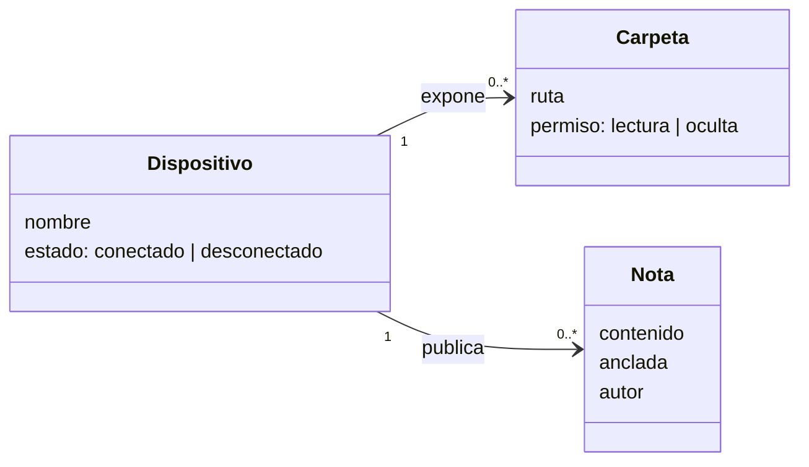
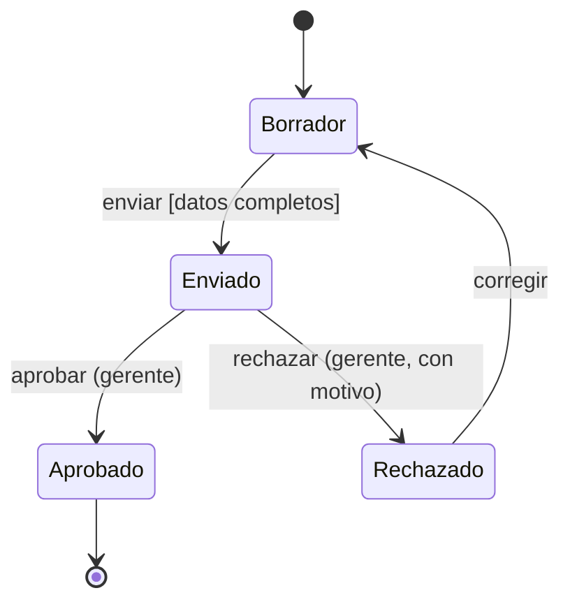
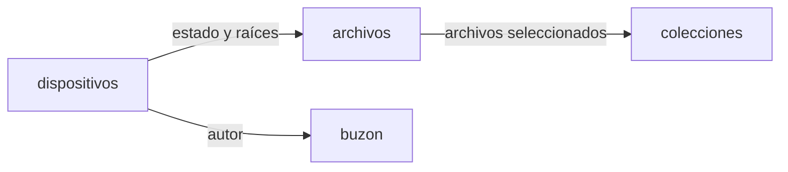

# Patrones de modelado del dominio

## Glosario

| Término | Definición | No confundir con / sinónimos prohibidos | Ejemplo | Contraejemplo |
| :--- | :--- | :--- | :--- | :--- |
| **Nota anclada** | Nota del buzón marcada para mostrarse siempre antes que las demás | "Favorita" (no existe) | Nota con `pinned = 1` | Nota reciente sin anclar |

- **Un término por concepto:** si el negocio dice "cliente" y el código `user`, se elige uno y se documenta la correspondencia.
- **Definición sin circularidad:** no se define "pedido" como "un pedido del cliente".
- Términos con significado distinto según el área ("cuenta" en facturación frente a "cuenta" de acceso) se separan con módulo o con nombres distintos.
- Las palabras de la interfaz son parte del glosario: lo que ve el usuario debe coincidir.

## Modelo conceptual

- **Entidades que el usuario reconoce**, con los atributos que aparecen en las reglas; sin claves técnicas, índices ni tablas intermedias.
- **Cardinalidad** en cada relación (`1`, `0..1`, `0..*`, `1..*`) y nombre de la relación en verbo.
- **Valores con significado de negocio** (dinero con moneda, periodos, estados) como atributos tipados en la descripción.
- `erDiagram` sirve si el equipo lo prefiere; el modelo sigue siendo conceptual.

## Ciclo de vida y estados

- Cada transición: **evento**, **quién** la provoca y **condición** (guarda) que la permite; cada guarda suele ser una regla `RN`.
- Lista también las transiciones **prohibidas** relevantes ("un pedido aprobado no vuelve a borrador").
- Estados con nombre de negocio, no flags técnicos (`activo`, `eliminado_logico`).

## Eventos y módulos

- **Eventos del dominio:** hechos pasados que interesan al negocio (`PedidoAprobado`, `NotaAnclada`), con qué los provoca y quién reacciona. Ayudan a descubrir reglas y procesos ("cuando se aprueba un pedido, se avisa a almacén").
- **Módulos o contextos:** áreas con su propio vocabulario y reglas (`buzon`, `archivos`, `dispositivos`). Por cada uno: responsabilidad en una frase, entidades propias, entidades que solo consulta de otros y el prefijo de sus IDs.

## Reglas de negocio

### Tipos

| Tipo | Qué expresa | Ejemplo |
| :--- | :--- | :--- |
| **Restricción** | Lo que debe o no puede ocurrir | Una nota debe tener texto o imagen |
| **Cálculo** | Cómo se obtiene un valor | El total es la suma de líneas menos el descuento, redondeado a 2 decimales al final |
| **Derivación o inferencia** | Un hecho que se deduce de otros | Un cliente es "frecuente" si tiene ≥ 5 pedidos en 90 días |
| **Habilitación o permiso** | Quién puede hacer qué y cuándo | Solo el gerente aprueba pedidos de más de 1.000 € |
| **Temporal** | Plazos, caducidades, ventanas | Un enlace de descarga caduca a las 24 h |

### Cómo escribirlas

- **Atómica:** una condición y un resultado. "Y" o "además" suelen indicar dos reglas.
- **Declarativa:** qué se cumple, no cómo se programa.
- **Verificable:** sin "rápido", "aproximadamente", "normalmente", "etc."; con cifras y unidades.
- **Con ejemplos:** al menos un caso que cumple y uno que no, y los valores límite (`10 MB` exactos, `10 MB + 1 byte`).
- **Con excepciones explícitas**, cada una con su motivo, o como regla propia.
- **Con motivo y origen:** por qué existe (negocio, ley, decisión técnica) y de dónde sale (`INT`, documento, código).

| Mal | Bien |
| :--- | :--- |
| "Las imágenes no pueden ser muy grandes" | "Una imagen adjunta no supera 10 MB (10 485 760 bytes) decodificada; 10 MB exactos se aceptan" |
| "Los usuarios autorizados pueden borrar notas" | "Cualquier dispositivo con IP confiable puede borrar cualquier nota" (y, si no es lo deseado, una `PRE`) |
| "Se valida el pedido" | Tres reglas: datos obligatorios, stock disponible, límite de crédito |

### Reglas inferidas del código

Al documentar un sistema existente, cada condición del código es una regla candidata con **origen "inferido del código"** (archivo y símbolo). Antes de marcarla como `acordado` hay que distinguir regla de negocio (alguien la quiere así) de decisión técnica o accidente (un límite elegido sin motivo), y preguntar lo dudoso (`PRE`).

## Anti-patrones

| Anti-patrón | Problema | Alternativa |
| :--- | :--- | :--- |
| Modelo que es el esquema de la base de datos | El negocio no lo reconoce; arrastra decisiones técnicas | Entidades y relaciones del negocio |
| Reglas escondidas en historias o en el código | Nadie las ve completas; se contradicen | Catálogo de `RN` enlazado |
| Reglas compuestas ("y además") | Imposibles de probar y de trazar por partes | Una regla por condición |
| Adjetivos sin cifras | Cada persona entiende un límite | Cifras, unidades y ejemplos límite |
| Excepciones en comentarios sueltos | Se olvidan al implementar | Excepciones dentro de la regla o como reglas propias |
| Sinónimos libres | Dos nombres, dos implementaciones | Glosario con sinónimos prohibidos |
