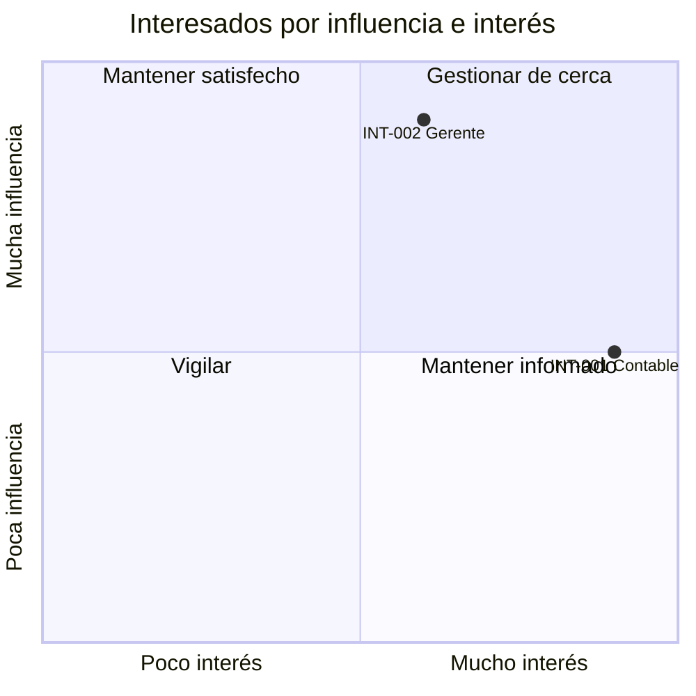

# Patrones de levantamiento

## Mapa de interesados

| ID | Rol | Interés en el producto | Influencia | Cómo se consulta |
| :--- | :--- | :--- | :-: | :--- |
| `INT-001` | Usuario operativo (contable) | Ahorrar tiempo en nóminas | Media | Entrevista y observación |
| `INT-002` | Gerente del despacho | Coste, errores, cumplimiento | Alta | Entrevista corta |
| `INT-003` | Sistema de nóminas existente | Formato de exportación | — | Documentación de su API |

- Incluye **sistemas** con los que el producto se integra y **normativa** (quien vela por ella es un interesado).
- Quien **decide** en caso de conflicto se identifica desde el principio.
- Proyecto personal: el autor es `INT-001`; otros usuarios previstos se listan aunque aún no se consulten.

## Elección de técnicas

| Técnica | Sirve para | Cuándo |
| :--- | :--- | :--- |
| **Entrevista individual** | Necesidades, contexto, reglas que la gente conoce de memoria | Siempre que haya acceso a usuarios |
| **Observación** (acompañar el trabajo) | Lo que la gente hace y no cuenta: atajos, hojas de cálculo, pasos olvidados | Procesos operativos y repetitivos |
| **Taller** con varios interesados | Alinear, priorizar, resolver contradicciones | Cuando hay versiones distintas del mismo proceso |
| **Análisis de documentos** | Normativa, contratos, procedimientos, plantillas | Dominios regulados o con procesos formales |
| **Análisis del sistema existente** | Reglas reales implementadas, casos límite | Sustituir o documentar un sistema |
| **Tickets y soporte** | Problemas reales y su frecuencia | Producto en marcha |
| **Cuestionario** | Confirmar a escala algo ya descubierto | Después de las entrevistas, no en su lugar |
| **Prototipo** | Reacciones concretas, requisitos de interfaz | Cuando las palabras no bastan |

## Preguntas que funcionan

| En vez de | Pregunta |
| :--- | :--- |
| "¿Usarías una app que…?" (hipotética) | "Cuéntame la última vez que tuviste que…" |
| "¿Te parecería útil X?" (dirigida) | "¿Qué hiciste después? ¿Qué fue lo más difícil?" |
| "¿Qué funcionalidades quieres?" | "¿Qué intentaste para resolverlo? ¿Por qué no te sirvió?" |
| "¿Siempre es así?" | "¿Cuándo no es así? ¿Qué pasa entonces?" (excepciones y casos límite) |

- **Excepciones:** la mayoría de las reglas de negocio aparecen al preguntar por lo que se sale de lo normal: cancelaciones, devoluciones, errores, festivos, usuarios sin permiso.
- **Números:** "¿cuántos al día?", "¿cuánto tarda?", "¿qué pasa si son 10 veces más?".
- **Citas literales** en las notas: el vocabulario del usuario alimenta el glosario.

## Entrevistar al usuario en el chat

Cuando el interesado es el propio usuario de la conversación:

1. Explica el objetivo en una línea y cuántos bloques habrá (2–4).
2. **Bloques de 3–5 preguntas** agrupadas por tema; nunca una lista de 20.
3. Tras cada bloque, **resume lo entendido** en viñetas, marca lo que interpretaste y pide confirmación o corrección.
4. Lo que el usuario no sabe se registra como `PRE` (con a quién preguntarlo) o `SUP`; no se insiste.
5. Al final, lista de requisitos candidatos y preguntas abiertas para que el usuario la valide.

## Análisis del sistema existente

Para documentar o sustituir algo ya construido:

1. Recorre rutas, pantallas, modelos, validaciones y mensajes de error: cada validación y cada condición de negocio es un requisito candidato.
2. Registra cada uno con su **origen en el código** (archivo y símbolo) y la marca **"inferido del código"**.
3. Separa lo que parece **intencional** de lo que parece **accidental** (un límite arbitrario, un caso sin manejar) y conviértelo en preguntas: "¿el límite de 30 notas es una regla o una decisión técnica?".
4. Contrasta con la documentación existente: las discrepancias son hallazgos ([severity.md](../../../standards/severity.md): el código manda sobre lo que hace hoy, no sobre lo que debería hacer).

## Registros

| Registro | Contenido mínimo | Archivo por defecto |
| :--- | :--- | :--- |
| Notas de sesión | Fecha, interesados, objetivo, hallazgos, citas, requisitos candidatos, nuevas `PRE`, `SUP` afectados, `DEC` | `elicitation/notas/AAAA-MM-DD-<tema>.md` |
| Preguntas (`PRE`) | Pregunta, por qué importa (qué bloquea), a quién, estado (abierta/respondida), respuesta y fecha | `elicitation/preguntas.md` |
| Decisiones (`DEC`) | Contexto, opciones consideradas, decisión, motivo, quién decidió, fecha | `elicitation/decisiones.md` |
| Interesados (`INT`) | Tabla del mapa | `elicitation/interesados.md` |
| Supuestos (`SUP`) | Se actualizan en el brief de `discovery` (validado o refutado, con la sesión que lo decidió) | `brief.md` |

Los **requisitos candidatos** aún no llevan ID de regla ni de historia: los asignan `domain-modeling` (`RN`) y `user-stories` (`HU`), citando la sesión de origen.

## Conflictos entre interesados

1. Registra las posiciones con su motivo y origen (`INT`, sesión).
2. Busca el interés detrás de cada posición (a menudo compatibles: "aprobación del gerente" frente a "rapidez" → aprobación solo por encima de un importe).
3. Si persiste, es una `PRE` dirigida a quien decide (`INT` con autoridad), con las opciones y sus consecuencias.
4. La resolución queda como `DEC`. Nunca se elige una posición en silencio.

## Anti-patrones

| Anti-patrón | Problema | Alternativa |
| :--- | :--- | :--- |
| Preguntar qué funcionalidades quieren | Respuestas de solución, no de necesidad | Preguntar por hechos pasados y problemas |
| Solo hablar con quien pide el proyecto | Falta la visión de quien lo usará | Mapa de interesados y consulta a los usuarios |
| Requisitos sin origen | Nadie sabe si se pueden cambiar ni a quién preguntar | Origen en cada requisito candidato |
| Dudas resueltas suponiendo | Se construye una interpretación | `PRE` con responsable |
| Decisiones solo en la memoria de alguien | Se reabren y se contradicen | `DEC` con motivo y fecha |
| Tratar lo inferido del código como requisito confirmado | Se perpetúan accidentes | Marcar "inferido" y confirmar |
