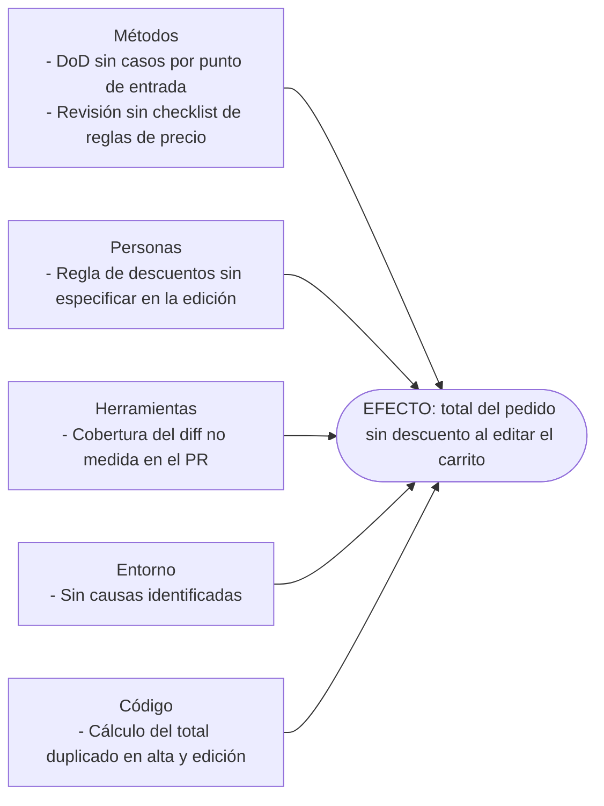

# Patrones de análisis de defectos

## Datos y veracidad

- Cada defecto del análisis tiene **identificador y fuente**: issue (`#123`), commit (`a1b2c3d`), reporte o post-mortem.
- Las frecuencias del Pareto se **cuentan** sobre esa lista, no se estiman. Si una categoría se asignó por inferencia (solo por el mensaje del commit, sin leer el cambio), se marca como inferida.
- Un commit con "fix" en el mensaje es un **candidato**: se confirma leyendo el diff (puede ser una errata, un refactor o una corrección de tests).
- Con pocos defectos (menos de ~20), el Pareto es **orientativo**: se presenta igual, con esa advertencia, y las conclusiones se formulan con prudencia.
- Lo que no se pudo consultar (gestor de issues sin acceso, historial reescrito) se declara como límite.

## Clasificación de defectos

| Dimensión | Valores habituales |
| :--- | :--- |
| **Tipo** | Lógica de negocio · validación de entrada · contrato o integración · datos y migraciones · concurrencia · configuración y entorno · interfaz y estado del cliente · rendimiento · seguridad · accesibilidad |
| **Fase de introducción** | Requisito · diseño · código · configuración · despliegue · dependencia externa |
| **Fase de detección** | Desarrollo · revisión de código · CI · pruebas manuales · staging · producción (usuario, monitorización) |
| **Por qué escapó** | Sin test para ese caso · test existente pero incorrecto o débil · caso no considerado (límite, negativo, combinación) · entorno de pruebas distinto de producción · control de CI ausente o saltado · revisión omitida o superficial · requisito ambiguo o cambiado · dependencia externa cambió |
| **Severidad** | Escala del kit ([severity.md](../../../standards/severity.md)) por el impacto que tuvo |
| **Regresión** | Sí (el comportamiento funcionaba o ya se había corregido) / No |

El **motivo de escape** es la dimensión más útil para actuar: dice qué control del proceso falló.

## Hotspots y regresiones en el historial

```bash
# Candidatos a corrección en el periodo (confirmar leyendo cada commit)
git log --since="6 months ago" --oneline -i -E --grep="fix|bug|hotfix|regres|revert"

# Archivos más tocados por esos commits (hotspots)
git log --since="6 months ago" -i -E --grep="fix|bug|hotfix" --name-only --format= \
  | grep -v '^$' | sort | uniq -c | sort -rn | head -15

# Reverts (cambios que hubo que deshacer)
git log --since="6 months ago" --oneline --grep="^Revert"

# Historial de un archivo caliente con sus diffs
git log -p --follow -- ruta/al/archivo.ts
```

En PowerShell, el recuento equivalente:

```powershell
git log --since="6 months ago" -i -E --grep="fix|bug|hotfix" --name-only --format= |
  Where-Object { $_ } | Group-Object | Sort-Object Count -Descending | Select-Object -First 15 Count, Name
```

- **Hotspot:** muchas correcciones en el mismo archivo o módulo. Cruzarlo con el tamaño y el número total de cambios: un archivo enorme que cambia a diario tendrá más correcciones por volumen.
- **Regresión:** una corrección sobre el mismo comportamiento que ya se corrigió (mismo issue reabierto, mensajes que citan un arreglo anterior, el mismo bloque modificado de nuevo por un fallo similar).
- Los tests de cada corrección: ¿el commit añade o modifica un test que falla sin la corrección?

## Causa raíz: 5 porqués

Se pregunta "¿por qué?" hasta llegar a algo que el equipo puede cambiar en su proceso, herramientas o código (normalmente 3–5 niveles). Dos cadenas por defecto relevante: **por qué se introdujo** y **por qué escapó**.

```text
Defecto: el total del pedido ignora el descuento al editar el carrito.
¿Por qué se introdujo? → La edición recalcula con una función distinta de la del alta.
¿Por qué hay dos funciones? → Se duplicó la lógica al añadir la edición.
¿Por qué escapó? → Los tests solo cubren el alta.
¿Por qué solo el alta? → La Definición de Terminado no exige casos para cada punto de entrada de una regla.
Causa raíz accionable: regla de precios duplicada + DoD sin cobertura por punto de entrada.
```

Se detiene cuando la respuesta es una persona ("se le olvidó"): se reformula como el control que no lo evitó.

## Diagrama de Ishikawa

Cinco ramas fijas. Cada rama lista **solo las causas con evidencia** del análisis; una rama sin causas se deja con "sin causas identificadas".

| Rama | Qué se busca |
| :--- | :--- |
| **Métodos** | Definición de Terminado, revisión de código, criterios de aceptación, pruebas de regresión antes del merge, proceso de release |
| **Personas** | Información y conocimiento: requisito incompleto o ambiguo, supuestos no confirmados sobre una API o regla, conocimiento concentrado (nunca culpas individuales) |
| **Herramientas** | CI no bloqueante o saltable, linters o tipos desactivados, ausencia de análisis estático, herramientas de test inadecuadas |
| **Entorno** | Diferencias entre local, staging y producción (datos, versiones, variables, red), datos de prueba poco realistas |
| **Código** | Acoplamiento, lógica duplicada, efectos secundarios, ausencia de tipos o validación en la frontera, deuda en el hotspot |



Reglas de sintaxis: etiquetas entre comillas dobles, saltos de línea con `<br/>`, sin comillas dobles dentro del texto (usa comillas simples) y un único nodo de efecto.

## Pareto 80/20

Se cuenta por **causa raíz** (o por motivo de escape) sobre la lista de defectos, se ordena de mayor a menor y se acumula el porcentaje. El **grupo vital** son las categorías que suman ~80 %.

| Categoría de causa | Defectos | % | % acumulado | Grupo |
| :--- | :-: | :-: | :-: | :--- |
| Sin test para el punto de entrada | 9 | 45 % | 45 % | Vital |
| Validación de entrada solo en el cliente | 5 | 25 % | 70 % | Vital |
| Diferencias de entorno (datos de staging) | 3 | 15 % | 85 % | Vital |
| Dependencia externa cambió | 2 | 10 % | 95 % | Útil |
| Otros | 1 | 5 % | 100 % | Útil |

Total: 20 defectos (lista en el anexo del informe). Un defecto puede tener una causa principal y otras contribuyentes: el Pareto usa **la principal** para que los totales cuadren.

## Matriz de acciones Kaizen

| Categoría | Definición |
| :--- | :--- |
| **Quick Win** | Dificultad baja, aplicable en menos de 48 h, frena la recurrencia inmediata (un test, una regla de lint, un check en el CI, un validador) |
| **Táctico** | Dificultad media, un ciclo o sprint (consolidar una lógica duplicada, añadir una etapa al pipeline, mejorar los datos de staging) |
| **Estratégico** | Dificultad alta o varios ciclos (rediseñar un módulo, cambiar el proceso de release, contract testing entre equipos) |

| ID | Acción concreta | Causa que ataca | Categoría | Dificultad | Plazo | Impacto | KPI de verificación |
| :--- | :--- | :--- | :--- | :--- | :--- | :--- | :--- |
| ACT-01 | Test de no regresión del total al editar | Sin test por punto de entrada | Quick Win | Baja | Inmediato (< 48 h) | Alto | El test falla con el código antiguo y pasa con el nuevo |
| ACT-02 | DoD: casos para cada punto de entrada de una regla | Sin test por punto de entrada | Táctico | Media | 1 ciclo | Alto | 0 defectos de esta causa en los 2 ciclos siguientes |
| ACT-03 | Unificar el cálculo del total en un único servicio | Lógica duplicada | Estratégico | Alta | 2–3 ciclos | Alto | 1 sola implementación; correcciones del hotspot −50 % en el trimestre |

- **Dificultad:** Baja · Media · Alta. **Plazo:** Inmediato (< 48 h) · Corto (1 ciclo) · Medio (2–3 ciclos) · Largo. **Impacto:** Crítico · Alto · Moderado (sobre la recurrencia de la familia de defectos).
- Cada acción ataca una causa del grupo vital y tiene un **KPI medible** con su fuente (tests, CI, gestor de issues).
- Primero los Quick Wins que frenan la recurrencia; los estratégicos se justifican con el Pareto.
- Si el proyecto usa responsables, se añade una columna; si es de una sola persona, se omite.

## Criterios de cierre

Un defecto o una causa se cierra cuando se cumplen los tres:

1. **No regresión verificada:** existe un test automatizado que **falla con el comportamiento anterior** a la corrección y pasa con el nuevo.
2. **Sin recurrencia:** la contramedida lleva desplegada **al menos 14 días** sin que reaparezca el síntoma (o un release completo si se publica con menos frecuencia).
3. **Lección incorporada:** el checklist del equipo, la Definición de Terminado o el pipeline de CI se actualizó para que la causa no se reintroduzca.

## Métricas

| Métrica | Cálculo | Para qué |
| :--- | :--- | :--- |
| Tasa de escape | Defectos encontrados en producción / defectos totales del periodo | Eficacia del proceso de pruebas |
| Tasa de regresión | Defectos que son regresiones / defectos totales | Eficacia de los tests de no regresión |
| Reapertura | Defectos reabiertos / defectos cerrados | Calidad de las correcciones |
| Tiempo hasta la corrección | Mediana entre el reporte y el despliegue de la corrección | Capacidad de respuesta |
| Correcciones por hotspot | Correcciones en el módulo / periodo | Efecto de las acciones estructurales |

Se comparan entre periodos con la misma definición; un único valor aislado dice poco.

## Anti-patrones

| Anti-patrón | Problema | Alternativa |
| :--- | :--- | :--- |
| "Error humano" como causa raíz | No cambia nada; genera miedo y ocultación | Preguntar qué control no lo evitó ni lo detectó |
| Acción "tener más cuidado" o "revisar mejor" | No es medible ni sostenible | Control automático o cambio concreto del proceso |
| Pareto con frecuencias estimadas | Prioriza sobre datos inventados | Contar sobre la lista de defectos con fuente |
| Corregir sin test de no regresión | El defecto vuelve | Test que falla con el comportamiento antiguo |
| Diez acciones para cada defecto | Ninguna se termina | Pocas, sobre el grupo vital, con KPI |
| Cerrar al desplegar la corrección | No se sabe si funcionó | Criterios de cierre: test, 14 días, lección |
| Analizar solo por qué se introdujo | Se repite el escape con otro defecto | Analizar también por qué escapó |
