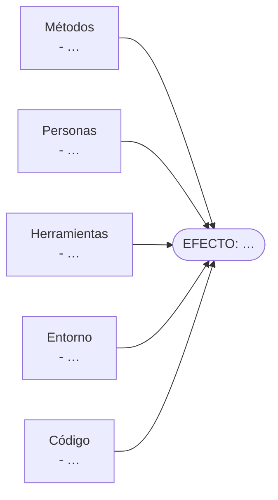

# Plantilla del análisis de defectos

````markdown
# Análisis de defectos — <defecto, release o periodo>

- Fecha: YYYY-MM-DD
- Alcance: <un defecto | lote: periodo, release o módulo> · <N> defectos analizados
- Definición de escapado: <llegó a producción | a usuarios | a un release etiquetado>
- Fuentes: <gestor de issues, git log desde <fecha>, post-mortems, reportes>
- Límites: <fuentes no accesibles, defectos sin información suficiente>

## 1. Resumen
<3–5 frases: qué falló, la causa dominante, por qué escapó y las acciones principales>

## 2. Defectos analizados

| ID | Fuente | Descripción breve | Tipo | Introducción | Detección | Por qué escapó | Severidad | Regresión |
| :--- | :--- | :--- | :--- | :--- | :--- | :--- | :--- | :---: |
| D-01 | #123 · `a1b2c3d` | | | | | | | Sí / No / Sin determinar |

<Las categorías asignadas por inferencia, sin leer el cambio, se marcan con (inferido). Regresión "Sí" solo con evidencia en git de que funcionó antes. Limpiezas y refactors van como observación, no como defectos.>

## 3. Hotspots y regresiones

| Archivo o módulo | Correcciones en el periodo | Regresiones | Observación |
| :--- | :-: | :-: | :--- |

## 4. Causa raíz

### 5 porqués — <defecto o familia>
- Por qué se introdujo: … → … → **causa raíz:** …
- Por qué escapó: … → … → **causa raíz:** …

### Diagrama de Ishikawa



## 5. Pareto 80/20

| Categoría de causa | Defectos | % | % acumulado | Grupo |
| :--- | :-: | :-: | :-: | :--- |

<Total y advertencia si hay menos de ~20 defectos: Pareto orientativo.>

## 6. Matriz de acciones Kaizen

| ID | Acción concreta | Causa que ataca | Categoría | Dificultad | Plazo | Impacto | KPI de verificación |
| :--- | :--- | :--- | :--- | :--- | :--- | :--- | :--- |
| ACT-01 | | | Quick Win | Baja | Inmediato (< 48 h) | | |
| ACT-02 | | | Táctico | Media | Corto (1 ciclo) | | |
| ACT-03 | | | Estratégico | Alta | Medio (2–3 ciclos) | | |

## 7. Criterios de cierre

| Defecto o causa | Test de no regresión | 14 días sin recurrencia | Lección incorporada (checklist o CI) | Estado |
| :--- | :--- | :--- | :--- | :--- |
| D-01 | `ruta/test` (falla con el código antiguo: sí/no) | desde YYYY-MM-DD | <dónde> | Abierto / Cerrado |

## 8. Métricas del periodo
<tasa de escape, regresión, reapertura; comparadas con el periodo anterior si existe. "n.a." con el motivo si las fuentes no permiten calcularla (p. ej. tasa de escape solo con commits de corrección en la rama principal)>

## 9. Seguimiento
<fecha de revisión de las acciones y de los KPI>

## Handoffs
- Hechos: <skill> (<alcance>)
- Pendientes: <skill> — <disparador y evidencia>

## Anexo: veracidad de lo cargado
<✅ leído completo · ◐ con líneas · ❌ con motivo; incluye las fuentes de datos consultadas>
````
