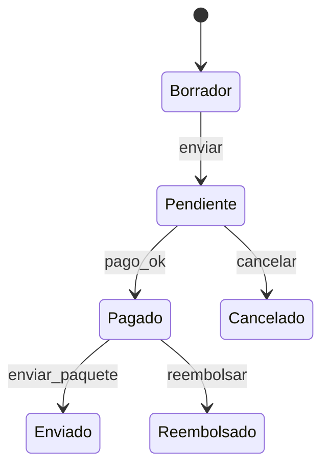

# Técnicas de diseño de casos

## Elegir técnica

| Forma del problema | Técnica |
| :--- | :--- |
| Una entrada con rangos o categorías (edad, importe, tipo de archivo) | Particiones de equivalencia + valores límite |
| Varias condiciones que se combinan en una decisión (descuento si cliente VIP **y** pedido > 100 **o** cupón) | Tabla de decisión |
| Una entidad que cambia de estado (pedido, suscripción, ticket) | Transiciones de estado |
| Muchos parámetros independientes con varios valores (navegador × idioma × plan × método de pago) | Combinaciones por pares (pairwise) |
| Una regla que debe cumplirse para cualquier entrada (ordenar, serializar y volver, invariantes de dinero) | Property-based testing |
| Comportamiento descrito por negocio | Escenarios Gherkin, diseñados con las técnicas anteriores |

Las técnicas se combinan: una tabla de decisión cuyas condiciones son rangos se completa con valores límite.

## Particiones de equivalencia

Divide cada entrada en clases donde el sistema debería comportarse igual. Un caso por clase.

Regla: "edad entre 18 y 65 para contratar".

| Clase | Ejemplo | Esperado |
| :--- | :-: | :--- |
| Válida: 18–65 | 30 | Acepta |
| Inválida: < 18 | 10 | Rechaza con `AGE_TOO_LOW` |
| Inválida: > 65 | 70 | Rechaza con `AGE_TOO_HIGH` |
| Inválida: no numérica / vacía / nula | `"abc"`, `""`, `null` | Rechaza con error de validación |

## Valores límite

En cada borde de una partición, prueba el borde y sus vecinos inmediatos: **17, 18, 19** y **64, 65, 66**. Para decimales, el paso mínimo relevante (99,99 / 100,00 / 100,01). Para longitudes: 0, 1, máximo − 1, máximo, máximo + 1. Para colecciones: vacía, un elemento, el límite de paginación y uno más.

Fallos típicos que encuentra: `>` en lugar de `>=`, límites distintos en cliente y servidor, desbordes de tamaño.

## Tablas de decisión

Una columna por regla; las condiciones arriba, las acciones abajo.

| Condición / Regla | R1 | R2 | R3 | R4 |
| :--- | :-: | :-: | :-: | :-: |
| Cliente VIP | S | S | N | N |
| Pedido > 100 € | S | N | S | N |
| **Descuento** | 15 % | 5 % | 5 % | 0 % |

Cada regla es un caso. Con condiciones que no influyen en algunas reglas, se colapsan (`—`). Una regla sin caso es un hueco; dos reglas con la misma combinación y acciones distintas son un defecto de especificación.

## Transiciones de estado

Dibuja estados y eventos; prueba **cada transición válida** y **las transiciones prohibidas más peligrosas**.



| Desde | Evento | Esperado |
| :--- | :--- | :--- |
| Pendiente | pago_ok | Pagado |
| Pagado | cancelar | **Rechazado** (prohibida: debe ser reembolso) |
| Enviado | pago_ok (webhook duplicado) | Sin cambio, idempotente |
| Cancelado | pago_ok (pago tardío) | Rechazado y alerta / reembolso automático |

## Combinaciones por pares (pairwise)

Probar todas las combinaciones de N parámetros explota (4 × 3 × 3 × 2 = 72). La mayoría de defectos de interacción dependen de **dos** parámetros: cubrir todos los pares reduce a ~12 casos. Herramientas: PICT, `allpairspy`, generadores en línea. Añade a mano las combinaciones de riesgo conocido (el navegador con más usuarios con el método de pago principal).

## Negativos y errores

Además de las clases inválidas, revisa:

- Entradas vacías, nulas, solo espacios, enormes, Unicode y emojis, caracteres de inyección (`' " < > ; --`).
- Fechas: 29 de febrero, cambio de hora, zonas horarias, fin de mes, fechas futuras o muy antiguas.
- Dinero: cero, negativos, redondeos, monedas distintas.
- Concurrencia: doble envío, dos usuarios editando a la vez.
- Dependencias: timeout, 500 o respuesta inesperada del servicio externo.
- Permisos: usuario sin rol, de otro tenant, sesión caducada.

## Property-based testing

En lugar de ejemplos, se declara una propiedad y la herramienta genera cientos de entradas, y reduce el contraejemplo al mínimo cuando falla. Herramientas: fast-check (JS/TS), Hypothesis (Python), jqwik (Java).

Propiedades útiles: ida y vuelta (`parse(format(x)) == x`), invariantes (`suma de líneas == total`, un importe nunca negativo), idempotencia (`f(f(x)) == f(x)`), comparación con un modelo simple.

## Escenarios Gherkin

```gherkin
Escenario: Rechazar un pedido por debajo del mínimo
  Dado un carrito con productos por 9,99 €
  Cuando el cliente confirma el pedido
  Entonces ve el error "El pedido mínimo es de 10 €"
  Y el pedido no se crea
```

- Un comportamiento por escenario; lenguaje de negocio, sin detalles de interfaz (`hace clic en #btn-3`).
- `Esquema del escenario` con `Ejemplos` para las particiones y los límites.
- El `Entonces` verifica un resultado observable, no "el sistema funciona".

## Anti-patrones

| Anti-patrón | Problema | Alternativa |
| :--- | :--- | :--- |
| Variaciones del camino feliz | Mucho test, poca detección | Particiones y límites |
| Valores "típicos" (edad 30, importe 50) | No tocan ningún borde | Límites a cada lado |
| Resultado esperado vago ("muestra un error") | No detecta el error equivocado | Código o mensaje concreto |
| Casos copiados con un valor cambiado | Mantenimiento caro | `test.each` / `parametrize` / esquema del escenario |
