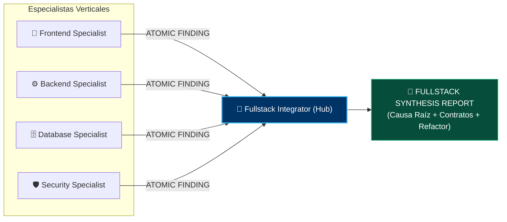

# 🤝 Protocolo de Interoperabilidad entre Auditores (Hub & Spoke Interop)

> **Estándar de comunicación y transferencia de diagnósticos forenses entre Especialistas Verticales y el Agente Integrador Fullstack.**

---

## 1. Filosofía de Separación y Síntesis

1. **Especialistas Verticales (Spokes):** Poseen *visión microscópica* de su área técnica. No hacen suposiciones sobre otras capas; auditan exclusivamente su dominio y emiten **Hallazgos Atómicos** estructurados.
2. **Integrador Fullstack (Hub):** Posee *visión telescópica y sistémica*. No se enfoca en auditar cada línea de CSS o query aislado; toma los hallazgos de los especialistas (o inspecciona las fronteras entre capas) para:
   - Detectar discrepancias de contratos (Frontend espera X, Backend entrega Y).
   - Localizar la causa raíz exacta de fallos de extremo a extremo (E2E).
   - Proponer refactorizaciones de arquitectura global y ordenamiento de carpetas.



---

## 2. Esquema Estándar de Hallazgo Atómico (Atomic Finding)

Todo especialista vertical debe documentar cada problema detectado bajo el siguiente formato serializable:

```markdown
### [FINDING-{DOMINIO}-{NUM}] {Título Breve del Hallazgo}

- **Dominio:** Frontend | Backend | Database | Security
- **Severidad:** CRITICAL | HIGH | MEDIUM | LOW | INFO
- **Ubicación:** `ruta/del/archivo.ext` (Líneas X-Y)
- **Tipo de Defecto:** Syntax | Typing | Performance | Security | Anti-Pattern | A11y
- **Impacto Local:** Breve explicación del daño dentro de su capa.
- **Evidencia / Snippet:**
  ```lang
  // Código defectuoso exacto
  ```
- **Remediación Propuesta:**
  ```lang
  // Código corregido o propuesta de refactor local
  ```
```

---

## 3. Matriz de Traducción hacia el Integrador Fullstack

Cuando el **Fullstack Integrator** consume hallazgos verticales, aplica las siguientes reglas de arbitraje:

| Conflicto / Síntoma | Declaración del Especialista | Veredicto del Integrador Fullstack |
| :--- | :--- | :--- |
| **Error 400 Bad Request en llamada de formulario** | **Backend:** "El payload no tiene el campo `userId` requerido por el schema."<br>**Frontend:** "El formulario envía el objeto del usuario logueado." | **Discrepancia de Contrato (Contract Mismatch):** Frontend envía `user.id` dentro de un objeto anidado `account: { id }`, pero el endpoint de Backend espera `userId` plano en el root del body. Propone armonizar el DTO o el middleware. |
| **Página lenta (TBT > 1.5s)** | **Frontend:** "La tabla de datos tarda en renderizar 500 filas."<br>**Database:** "La consulta SQL toma 950ms por un join secuencial sin índice." | **Cascada de Rendimiento E2E:** 1) Añadir índice compuesto en BD (reduce a 15ms). 2) Implementar paginación virtual en Frontend (reduce nodos DOM de 500 a 20). |
| **Error 401/403 intermitente** | **Backend:** "El token JWT no llega en el header Authorization."<br>**Frontend:** "El interceptor Axios adjunta el token desde localStorage." | **Falla de Ciclo de Vida / Asincronía:** El primer request del componente se dispara antes de que la inicialización del store de auth resuelva la sesión. Propone Router Navigation Guard previo al montaje. |

---

## 4. Modos de Ejecución Compatibles

### Modo A: Cascada Desacoplada (Asíncrono)
1. El usuario invoca al especialista vertical relevante para auditar una carpeta puntual (ej. `src/frontend/views`).
2. El especialista genera un archivo de hallazgos en `reports/findings-frontend.md`.
3. El usuario invoca al `00_fullstack_integrator` pasándole dicho archivo junto con el código de backend.
4. El Integrador sintetiza el informe final.

### Modo B: Análisis Autónomo Directo (One-Shot Fullstack)
1. El usuario invoca directamente al `00_fullstack_integrator` sobre la raíz de un repositorio completo.
2. El Integrador evalúa simultáneamente las fronteras entre frontend y backend, la estructura de carpetas, los contratos de API y los puntos de dolor de integración sin requerir la ejecución previa de los especialistas.
