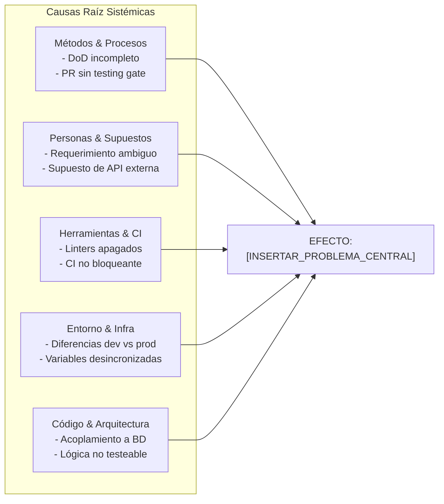

# 🎯 Matriz de Acción Kaizen y Análisis de Causa Raíz

> **Propósito:** Registrar el análisis retrospectivo de incidentes o regresiones recurrentes mediante el Diagrama de Ishikawa (5 ramas), aislar las causas dominantes según la Ley de Pareto (80/20) y estructurar contramedidas priorizadas según su Dificultad, Plazo e Impacto.

---

## 📌 Identificación del Problema o Regresión

- **Incidente / Defecto Analizado:** `[DESCRIPCIÓN DEL FALLO, REGRESIÓN O DEUDA CRÍTICA]`
- **Módulo Afectado:** `[RUTA_DEL_COMPONENTE_O_SERVICIO]`
- **Impacto en Producción / Negocio:** `[AFECTACIÓN A USUARIOS, PÉRDIDA FINANCIERA O BLOQUEO DE RELEASES]`
- **Fecha de Detección:** `[AAAA-MM-DD]`

---

## 🐟 1. Diagrama de Ishikawa (Causa y Efecto en 5 Ramas)

---

## 📊 2. Aislamiento Pareto (80/20)

| Categoría de Causa Raíz | Frecuencia de Ocurrencia | % Acumulado | Clasificación |
| :--- | :--- | :--- | :--- |
| **`[Causa Dominante 1]`** | `[N]` incidentes | `[%]` | **Crítica (Vital Few - 80% del impacto)** |
| **`[Causa Dominante 2]`** | `[N]` incidentes | `[%]` | **Crítica (Vital Few - 80% del impacto)** |
| **`[Causa Menor 3]`** | `[N]` incidentes | `[%]` | Útil / Secundaria (*Useful Many*) |
| **`[Causa Menor 4]`** | `[N]` incidentes | `[%]` | Útil / Secundaria (*Useful Many*) |

---

## 🚀 3. Matriz de Priorización de Acciones Correctivas

| ID Acción | Acción Correctiva Concreta | Categoría | Dificultad | Plazo | Impacto | Métrica de Verificación (KPI) |
| :--- | :--- | :--- | :--- | :--- | :--- | :--- |
| **ACT-01** | `[Ej. Agregar validador Zod y middleware]` | **Quick Win** | Baja | Inmediato (<48h) | Crítico | 0 rechazos de schema en runtime |
| **ACT-02** | `[Ej. Inyectar mock de reloj en billing]` | Táctico | Media | Corto (1 sprint) | Alto | 100% determinismo en tests |
| **ACT-03** | `[Ej. Script k6 y gate de p95 en CI]` | Estratégico | Media | Medio (2 sprints) | Alto | p95 < 400ms verificado en CI |
| **ACT-04** | `[Ej. Refactor desacoplamiento DI]` | Estratégico | Alta | Medio (3 sprints) | Alto | Cobertura sin mocks de BD |

---

## 🏁 4. Criterios de Cierre y Verificación Kaizen
1. **Verificación de No-Regresión:** La suite de pruebas unitarias o de integración automatizada falla cuando se simula el comportamiento previo a la corrección.
2. **Cierre Formal de Incidencia:** La contramedida ha sido desplegada y monitoreada durante al menos 14 días sin recurrencia del síntoma.
3. **Lección Aprendida Documentada:** El checklist del equipo o el pipeline de CI/CD ha sido actualizado para prevenir la reintroducción de esta causa raíz.
